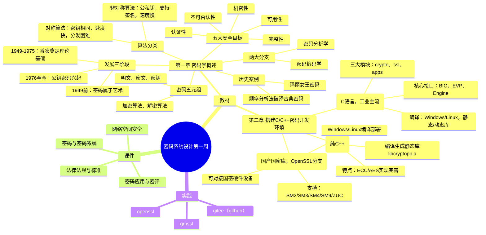

## 20241409司马平珏第一周预习报告 
### 学习内容

- [《Windows C/C++加密解密实战》](https://weread.qq.com/web/bookDetail/a0332190813ab78fag011422?wfrom=bookDetailH5)第 1，2 章
    - 第一章概念复习
    - 第二章主要在 Linux（Ubuntu,openEuler）上把软件更新到最新版(3.0版本以上)，如果默认不是，参考下面脚本

openssl 安装,opensslinstall.sh：
```
#! /bin/sh

### openssl

VER=3.3.2
CUROPENSSL=openssl-${VER}

cd
ROCHOME=$(pwd)

if [ ! -d rocopenssl ];
then
    mkdir rocopenssl
    mkdir rocopensslsrc
    mkdir rocopenssldir
fi

if [ ! -f ~/${CUROPENSSL}.tar.gz ]; 
then
    wget https://www.openssl.org/source/${CUROPENSSL}.tar.gz
    tar -zxvf ~/${CUROPENSSL}.tar.gz -C ~/rocopensslsrc
	
    cd ~/rocopensslsrc/${CUROPENSSL}
    ./config --prefix=${ROCHOME}/rocopenssl --openssldir=${ROCHOME}/rocopenssldir 
    make
#    make test
    sudo make install
fi


UNAME=$(uname -a)
result=$(echo ${UNAME} | grep "ubuntu")
if [ "$result" != "" ]; then
    sudo mv -f /usr/lib/x86_64-linux-gnu/libcrypto.so.3 /usr/lib/x86_64-linux-gnu/libcrypto.so.3.rocbaknewopenssl
    sudo mv -f /usr/lib/x86_64-linux-gnu/libssl.so.3 /usr/lib/x86_64-linux-gnu/libssl.so.3.rocbaknewopenssl
    sudo ln -sf ${ROCHOME}/rocopenssl/lib64/libcrypto.so.3 /usr/lib/x86_64-linux-gnu/libcrypto.so.3
    sudo ln -sf ${ROCHOME}/rocopenssl/lib64/libssl.so.3 /usr/lib/x86_64-linux-gnu/libssl.so.3
  
    sudo mv -f /usr/bin/openssl /usr/bin/opensslbak
    sudo ln -sf ${ROCHOME}/rocopenssl/bin/openssl /usr/bin/openssl
    
fi
 

UNAME=$(uname -a)
result=$(echo ${UNAME} | grep "WSL")
if [ "$result" != "" ]; then
    sudo mv -f /usr/lib/x86_64-linux-gnu/libcrypto.so.3 /usr/lib/x86_64-linux-gnu/libcrypto.so.3.rocbaknewopenssl
    sudo mv -f /usr/lib/x86_64-linux-gnu/libssl.so.3 /usr/lib/x86_64-linux-gnu/libssl.so.3.rocbaknewopenssl
    sudo ln -sf ${ROCHOME}/rocopenssl/lib64/libcrypto.so.3 /usr/lib/x86_64-linux-gnu/libcrypto.so.3
    sudo ln -sf ${ROCHOME}/rocopenssl/lib64/libssl.so.3 /usr/lib/x86_64-linux-gnu/libssl.so.3
  
    sudo mv -f /usr/bin/openssl /usr/bin/opensslbak
    sudo ln -sf ${ROCHOME}/rocopenssl/bin/openssl /usr/bin/openssl
    
fi
openssl version

rm ~/${CUROPENSSL}.tar.gz


```

gmssl 安装 gmsslinstall.sh：
```
#!/bin/bash

# 目录名称
GmDIR="GmSSL-3.1.1-Linux"

# 检查目录是否存在
if [ -d "$GmDIR" ]; then
    echo "已经安装了GmSSL，脚本将退出。"
    exit 0
fi

# 文件名称
FILE="GmSSL-Linux.sh"
URL="https://github.com/guanzhi/GmSSL/releases/download/v3.1.1/GmSSL-3.1.1-Linux.sh"
TEMP_FILE="GmSSL-3.1.1-Linux.sh"

# 检查文件是否存在
if [ ! -f "$FILE" ]; then
    # 下载并重命名文件
    wget -O "$TEMP_FILE" "$URL"
    mv "$TEMP_FILE" "$FILE"

fi

cp ./GmSSL-Linux.sh ~
cd ~
./GmSSL-Linux.sh 

echo "安装GmSSL成功"

echo 'export PATH="$HOME/GmSSL-3.1.1-Linux/bin:$PATH"' >> ~/.bashrc
echo 'export LD_LIBRARY_PATH="$HOME/GmSSL-3.1.1-Linux/lib:$LD_LIBRARY_PATH"' >> ~/.bashrc
. ~/.bashrc
echo "Init GmSSL ENV successfully"

```
- [课程 mindmap](https://www.processon.com/mindmap/66bcf83cce68f62ecf3f63fc?from=pwa)

### AI 对学习内容的总结
#### 《Windows C/C++加密解密实战》第1‑2章内容总结
#### 第1章 密码学概述
本章从历史案例入手，介绍密码学基础理论。
1. **历史案例：玛丽女王的密码**
以玛丽女王“巴宾顿阴谋”案例讲解古典密码，介绍**频率分析法**破译密码的原理，体现密码学对现实的影响。
2. **密码学发展简史**
密码学分为两大分支：**密码编码学**（设计加密）、**密码分析学**（破解密文）。发展分为三阶段：
- 1949年前：密码学属于艺术，没有系统化理论；
- 1949‑1975年：香农发表论文奠定密码学理论基础，以单密钥（对称）体制为主；
- 1976至今：密码学蓬勃发展，诞生公钥密码，RSA、ECC、SHA、AES陆续出现，同时MD5、SHA‑1等算法被破解。
梳理关键历史节点：置换密码诞生、恩尼格玛密码机、非对称密码提出、DES的公布与破解、AES选定、我国王小云教授破解MD5等事件。
3. **密码学五大安全问题**
- **机密性**：防止信息泄露，依靠加密；
- **可用性**：保障资源可正常访问；
- **完整性**：检测数据被篡改，使用哈希指纹；
- **认证性**：确认消息来源身份；
- **不可否认性**：用户不能抵赖行为，依靠数字签名。
4. **密码五元组**
明文、密文、密钥、加密算法、解密算法，满足 p = D_k(E_k(p))，加密解密互为逆运算。
5. **加解密算法分类**
- **对称算法**：加解密密钥相同。优点：速度快、密钥短；缺点：密钥分发困难、密钥管理复杂，无法实现不可否认。
- **非对称（公钥）算法**：分为公钥（公开）、私钥（保密）。优点：密钥分发简单，支持数字签名；缺点：运算慢，同等安全需要更长密钥，密文会膨胀。

#### 第2章 搭建C和C++密码开发环境
本章讲解3套主流密码库：OpenSSL、Crypto++、GmSSL，讲解源码编译、环境配置、简单验证。
#### 2.1 OpenSSL库（C语言实现，工业最常用）
1. **整体架构**：分为密码算法库`crypto`、SSL协议库`ssl`、应用工具`apps`三大模块。
- 支持8种对称算法、4种非对称算法、多类摘要算法，同时提供证书、ASN.1/PEM编码管理能力。
- 两大核心抽象接口：
  - **BIO接口**：统一封装文件、Socket网络IO，屏蔽平台差异；
  - **EVP接口**：高层抽象API，封装对称、非对称、签名、摘要算法，同一套代码切换不同算法。
  - Engine安全框架：可对接硬件密码设备，替换底层密码实现。（核对注：OpenSSL 3.0 起 ENGINE 已弃用，改用 provider 机制）
2. **版本说明**：1.1.1新版本增加国密支持；1.0.2 系列（最后版本 1.0.2u）多用于老项目，官方已经停止维护 0.9.8、1.0.0 等旧版本。
3. **Windows编译**：依赖ActivePerl、VS编译器，可编译32/64位、Debug/Release、静态库`no‑shared`、动态库`shared`；编译完成配置头文件、库目录，链接`libcrypto.lib`，依赖系统库`ws2_32.lib`、`Crypt32.lib`，提供测试demo验证库是否可用。
4. **Linux编译**：下载源码，`./config`配置，`make && make install`编译安装；需要处理旧系统自带OpenSSL冲突，通过软链接更新头文件、动态库路径，避免链接到老版本。
5. **命令行工具**：可查看版本、列举支持密码算法，执行加密、证书等操作。

#### 2.2 Crypto++（纯C++密码库）
- 全部使用C++编写，椭圆曲线、AES实现完善；Linux下解压后直接`make`生成静态库`libcryptopp.a`。
- 示例演示AES块加密、解密基础代码。

#### 2.3 GmSSL（国产国密密码库，OpenSSL分支）
1. **定位**：开源国密工具箱，兼容OpenSSL接口，支持SM2/SM3/SM4/SM9/ZUC国密算法，支持国密SSL/TLS，对接SKF/SDF硬件密码设备，商业友好BSD类许可证。
2. **国密算法概念**
    - SM2：椭圆曲线公钥算法，对标 RSA（算法能换，证书链与协议套件不能直接换）；
    - SM3：哈希摘要算法，对标 SHA‑256；
    - SM4：分组对称加密，对标 AES；
    - SM9：基于标识密码算法。
3. **编译部署**
    - Windows：依赖ActivePerl、VS，nmake编译安装，配置环境变量使用`gmssl`命令行；
    - Linux：`./config --prefix=安装路径`，make编译；处理动态库软链接解决依赖缺失；老Linux系统需要升级Perl版本；
    - 提供代码demo，复用EVP接口验证库加载；命令行可以直接计算SM3哈希值。

小结：第2章重点是工程实操，讲解Windows、Linux平台下编译、部署密码库，区分静态库、动态库配置要点；三个库定位不同：OpenSSL通用，Crypto++适合C++项目，GmSSL面向国内国密开发场景。
### 对 AI 总结的反思与补充
#### 反思与补充
- AI的总结结构比较清晰，适合快速厘清章节的结构框架和快速回顾，但重点不够突出，主要说了“是什么”，没有说“为什么”和"怎么做"
- 一条主线记密码学：古典密码 → 对称密码 → 公钥密码 → 现代/国密算法。
- 核对后发现三处要更正：①「Engine 安全框架」是 OpenSSL 1.x 的说法，3.0 起 ENGINE 已弃用、改用 provider（我在虚拟机里跑 `openssl list -providers`，看到 default provider 在工作）；②「1.0.2m 稳定版」版本号不对，1.0.2 系列最后一个是 1.0.2u；③「SM2 替代 RSA」「SM4 替代 AES」是"对标"不是"替代"——算法本身能换，但证书链、协议套件、生态不一样，不能直接替换。

### 学习思维导图
#### 思维导图
      



### 基于 AI 的学习

#### 学习内容

**AI：**
你能说出来密码学五元组具体包含哪五个要素吗？

**我：**
明文、密文、密钥、加密算法、解密算法。

**AI：**
很好，那请你思考，明文和密文之间依靠什么要素才能够完成互相转换？

**我：**
依靠密钥，配合加密、解密算法。

**AI：**
那如果密钥泄露了，会对明文、密文带来什么样的影响？

**我：**
攻击者拿到密钥，就可以把截获的密文还原成原始明文，信息就泄密了。

**AI：**
不错。请思考：密码五元组中公式 p = D_k(E_k(p))，这个公式表达的含义是什么？

**我：**
用密钥k对明文p加密得到密文，再用同一个密钥k解密密文，能够还原回原始明文p。

**我：**
针对我密码学五元组知识点，我理解了吗？

**AI：**
你的整体理解基本到位。关键点都可以表述出来，但有一处需要留意：该公式成立的前提是**正确密钥k+算法无缺陷**；如果密钥错误，是无法还原出明文p的。

**我：**
我的回答结束了，请对我的回答进行评价总结。

**AI：**
✅评价总结：
1. 你可以完整说出五元组5个组成元素，理解明文、密文、密钥、加解密算法之间的依赖关系；
2. 能够意识到密钥泄露带来的安全风险，理解加解密互逆的数学公式含义；
3. 小疏漏：没有主动提到公式成立的前置条件，错误密钥下不能恢复明文。
总体：已经基本掌握密码学五元组核心概念，后续可以结合对称/非对称算法，思考两种体制下五元组中密钥的区别。

---


**AI：**
OpenSSL为什么要设计EVP接口，直接调用底层算法函数不行吗？

**我：**
直接调用底层函数，不同算法的函数名、参数都不一样，代码不好复用。EVP做了封装。

**AI：**
很好，那EVP主要对哪几大类密码算法做了高层封装？

**我：**
对称加密算法、非对称算法、数字签名、摘要哈希算法。

**AI：**
那使用EVP接口编写加密代码，如果我要把AES加密换成SM4国密加密，我的业务代码需要做很大改动吗？为什么？

**我：**
改动很小。因为EVP是抽象层，只需要更换初始化的时候指定的算法标识，上层逻辑不用改。

**AI：**
那BIO接口和EVP接口的职责有什么区别？

**我：**
EVP负责密码算法运算（加密、哈希、签名）；BIO负责IO，文件读写、socket网络读写。

**我：**
针对我OpenSSL的EVP高层抽象接口知识点，我理解了吗？

**AI：**
整体理解较好，分清了EVP的定位，也能区分EVP与BIO职责。有一点补充：EVP只是API封装，使用前需要调用`OpenSSL_add_all_algorithms()`加载全部算法，否则EVP找不到对应算法。

**我：**
我的回答结束了，请对我的回答进行评价总结。

**AI：**
✅评价总结：
1. 理解EVP接口设计目的：屏蔽底层算法差异，提高代码复用性；
2. 清楚EVP封装的四大类密码算法，能理解替换算法时代码改动小的优势；
3. 可以区分EVP（算法运算）和BIO（IO操作）两个重要OpenSSL组件的分工；
4. 遗漏知识点：使用EVP之前需要初始化加载密码算法，否则接口调用会失败。

总体：对EVP核心思想掌握良好，实际编码时不要遗忘算法初始化步骤。建议后续可以看一段EVP摘要的示例代码加深印象。

### 学习实践过程遇到的问题与解决方式

- 问题 1:我的 Ubuntu 自带的 openssl 版本已经是3.0.13，不需要更新了，但是在安装开发库（sudo apt install libssl-dev -y）时，命令行显示dpkg 锁被占用，无法安装。询问 AI 后，输入：
```
sudo kill 9454
sudo rm /var/lib/dpkg/lock-frontend
sudo rm /var/cache/apt/archives/lock
```
杀死自动更新进程，释放锁后再重新安装就成功了


- 问题 2：安装 gmssl 时，使用资料中给的脚本始终无法成功，询问 AI 后，命令行输入以下命令后就安装成功了：
```
sudo apt update
sudo apt install -y build-essential cmake git perl
git clone https://github.com/guanzhi/GmSSL.git
cd GmSSL
mkdir build
cd build
cmake 
make
make test
sudo make install
sudo ldconfig
```

### 参考资料
- AI工具(你使用的AI工具及其链接)
  - [豆包](https://www.doubao.com/)
  - [opencode](https://opencode.ai/zh)
  - [智谱GLM-5.3](https://open.bigmodel.cn)   
- 图书
  - [《Windows C/C++加密解密实战》](https://weread.qq.com/web/bookDetail/a0332190813ab78fag011422?wfrom=bookDetailH5)
  - ...
- 网站
  - [gmssl官网](https://gmssl.org/)
  - [openssl](https://openssl-library.org/)

### 作业提交要求

- 姓名 / 学号：司马平珏 / 20241409
- 课程：密码系统设计（第一周）
- Markdown 文件：`20241409司马平珏《密码系统设计》.md`
- PDF 文件：`20241409司马平珏《密码系统设计》第 1 周.pdf`
- 代码托管链接：见仓库根目录 `README.md`（Skill 迭代开发部分）
- 本仓库内容：`handmade/`（手工稿与反思）· `skill/v1–v7`（七版 Skill）· `output/v1–v7`（各版产出）· `feedback/`（每轮反馈）· `report/`（进化分析）
