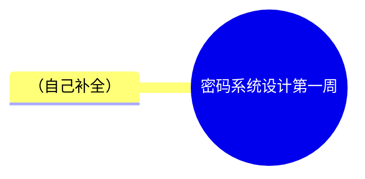
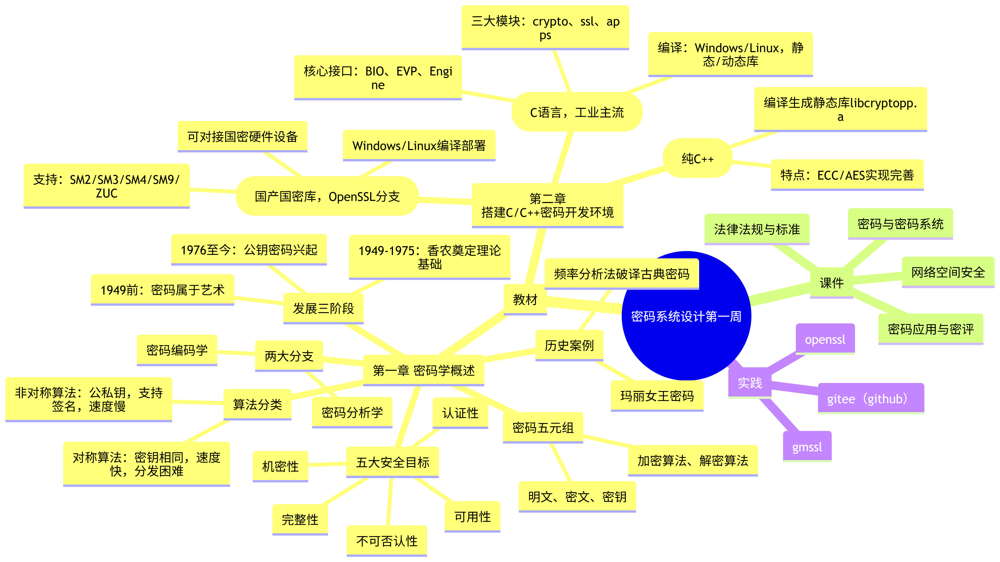

# 20241409 司马平珏《密码系统设计》第一周预习报告

> **手写底稿说明**：本文件是 Phase 1 的手工版本，正文由本人逐节手写填写，`>` 引用块里的问句是写作提纲（写完删掉）。
> 不使用 AI 生成正文；仅在 §2「AI 对学习内容的总结」处按作业要求使用 AI 工具，并保留原始对话。

- 课程：密码系统设计
- 周次：第一周
- 姓名/学号：司马平珏 / 20241409
- 完成日期：2026-11-__

---

## 学习内容

> 写什么：本章两章分别读到哪里、重点是什么、配套看了什么（课件/mindmap/视频）。
> 控制在 8 行以内，不要抄目录。

- 《Windows C/C++加密解密实战》
  - 第 1 章：
  - 第 2 章：
- 课程 mindmap：
- 其他（课件 / 视频 / 文档）：

---

## AI 对学习内容的总结（1 分）

> 写什么：
> 1. 用的什么工具、什么提示词（原样贴出来）；
> 2. AI 总结原文（可整理排版，但不要自己重写内容）；
> 3. 一句话说明你给了它哪些材料（章节范围）。
>
> 注意：这一节 AI 的角色是"总结器"，不是"代写器"，所以要把提示词和原文都留下，方便第 2 节对照。

**使用的工具与提示词**

```
（粘贴提示词原文）
```

**AI 总结**

（粘贴 AI 输出）

---

## 对 AI 总结的反思与补充（2 分）

> 写什么：这一节是拿分关键，不要写"AI 总结得很好，我学到了很多"。
> 建议按「AI 的 3 个问题 + 我的 2 处补充」来写，每条都要具体到句子或术语。
>
> 可以对照素材包里记的易错点：密码 vs 口令、SM4 分组长度、SM2 是不是"国密 RSA"、
> provider 与 ENGINE 的关系、有没有提法规与密评。

**AI 总结存在的问题**

1.
2.
3.

**我的补充**

1.
2.

---

## 学习思维导图（2 分）

> 写什么：Mermaid mindmap 代码 + 一张渲染截图（截图放 `handmade/mindmap.png`，用 `` 引用）。
> 结构建议：教材（第 1 章概念 / 第 2 章环境）→ 实践（openssl / gmssl / gitee）→ 法规标准。
> 注意：mindmap 节点的文字要短（≤12 字），别混用中英文标点和斜杠，也别带空格——否则渲染出来文字被拆成好几段，导图会很挤。
> 渲染命令：`python tools/render_mermaid.py handmade/homework1.md handmade/mindmap.png`





---

## 基于 AI 的学习（2 分）

> 写什么：挑 **2 个**自己确实没想清楚的概念，让 AI 用苏格拉底式提问，一次一个问题。
> 每个概念记录：起始提示词 → 至少 3 轮问答（含我答不上来时反问 AI）→ 最后让 AI 评价我的理解。
> 关键是把"我卡在哪"写出来，不是把 AI 的答案抄一遍。
>
> 素材包里预判的卡壳点（选两个）：
> - 对称加密已经够快，为什么还需要非对称加密？
> - MAC 和数字签名都能防篡改，为什么只有签名能防抵赖？
> - OpenSSL 3 的 provider 到底解决了 1.1.1 时代 ENGINE 的什么问题？

### 概念一：

**起始提示词**

```
请你以苏格拉底的方式对我进行提问，一次一个问题。我在学习……
```

**对话记录**

| 轮次 | 谁 | 内容 |
|:---|:---|:---|
| 1 | AI | |
| 2 | 我 | |
| 3 | AI | |

**我的理解（对话后自己总结，不许抄 AI）**

### 概念二：

（同上结构）

---

## 学习实践过程遇到的问题与解决方式（2 分）

> 写什么：至少 2 个，最好是"报错 → 排查 → 解决 → 结论"四段式，贴真实命令和真实报错。
> 可以写：编译安装 OpenSSL 3.3.2、替换系统库导致的问题、GmSSL 环境变量、
> SM3 测试向量对不上、WSL 下 sudo 丢环境变量。
> 不要编造输出，粘贴自己终端里的内容。

### 问题 1：

**现象**

```
（粘贴报错）
```

**排查过程**

**解决方式**

```
（粘贴命令）
```

**结论 / 以后怎么避免**

### 问题 2：

（同上结构）

---

## 作业提交要求（1 分）

- [ ] Markdown 文件命名：`20241409司马平珏《密码系统设计》.md`
- [ ] 导出 PDF：`20241409司马平珏《密码系统设计》第 1 周.pdf`
- [ ] 代码托管链接：
- [ ] 参考资料（AI 工具、图书、网站）

---

## 提交前自检

- [ ] 五个评分点每节都有内容，没有 `XXX` 占位符
- [ ] Mermaid 代码能在 mermaid.live 预览通过，截图已放
- [ ] 苏格拉底部分有 2 个概念、每个至少 3 轮、有我反问 AI 的记录
- [ ] 问题与解决里是真实报错，不是"我遇到了困难，然后解决了"
- [ ] 全文读完一遍，删掉所有提纲引用块