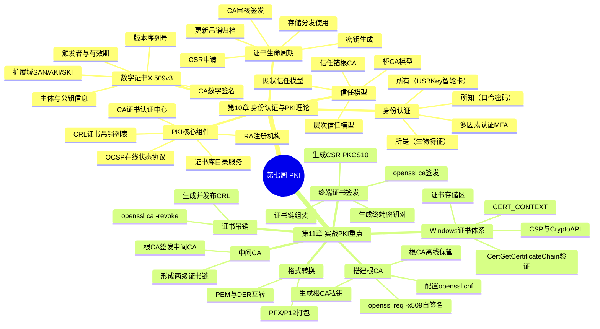

> 【归档】第 7 周预习报告的早期版本，留档备查。

---

---

# 第七周预习报告

**学号：** 20241409
**姓名：** 司马平珏
**课程：** 密码系统设计
**学习内容：** 《Windows C/C++加密解密实战》第10章（身份认证和PKI理论基础）、第11章（实战PKI，重点）

---

## 一、AI 对学习内容的总结（1分）

### 总结

本周学习内容围绕**公钥基础设施（PKI, Public Key Infrastructure）**展开，分为理论基础与实战两大部分：

**第10章 身份认证和PKI理论基础**主要讲解了以下内容：

1. **身份认证基础**：介绍了身份认证的三种基本方式——你知道的东西（密码、口令）、你拥有的东西（USB Key、智能卡）、你是谁（生物特征），以及多因素认证（MFA）的概念。

2. **数字证书与X.509标准**：数字证书是将公钥与实体身份绑定的电子文件，遵循X.509 v3标准。证书主要字段包括版本号、序列号、签名算法、颁发者（Issuer）、有效期、主体（Subject）、主体公钥信息、颁发者唯一标识符、主体唯一标识符、扩展域以及CA的数字签名。

3. **PKI核心组件**：
   - **CA（Certificate Authority，证书认证中心）**：负责证书的签发、管理和吊销，是PKI的信任锚。
   - **RA（Registration Authority，注册机构）**：作为CA的代理，负责审核申请人身份。
   - **证书库/目录服务器**：存储已签发的证书，供公众查询。
   - **证书吊销列表（CRL, Certificate Revocation List）**：由CA定期发布，列出已被吊销的证书序列号。
   - **OCSP（在线证书状态协议）**：实时查询单张证书状态，弥补CRL的延迟问题。

4. **信任模型**：介绍了层次信任模型（根CA→中间CA→终端实体）、网状信任模型和桥CA模型。浏览器/操作系统预置的根CA列表构成了信任锚。

5. **证书生命周期**：包括密钥生成→证书申请（CSR）→身份审核→CA签发→证书存储与分发→使用→更新/吊销→归档。

**第11章 实战PKI（重点）**主要讲解如何使用OpenSSL从零搭建一套私有CA并完成证书全生命周期操作：

1. **搭建根CA**：生成根CA私钥，自签名生成根证书（Root Certificate），配置openssl.cnf中的CA参数。
2. **搭建中间CA（可选）**：根CA签发中间CA证书，形成两级证书链，遵循"根CA离线保管"的安全实践。
3. **终端实体证书申请与签发**：申请人生成密钥对→提交CSR（证书签名请求）→CA审核并用自己的私钥签发证书→形成证书链（终端证书+中间CA证书+根证书）。
4. **证书格式转换**：PEM/DER格式互转，PFX/P12打包私钥和证书。
5. **证书吊销操作**：使用`openssl ca -revoke`命令吊销证书，更新CRL并发布。
6. **证书验证流程**：验证证书链完整性、有效期、主机名（SAN扩展）、吊销状态。

---

## 二、对 AI 总结的反思与补充（2分）

### AI总结的问题

1. **AI总结偏概念罗列，缺少Windows平台特色**：本书是《Windows C/C++加密解密实战》，第9章刚学完CSP和CryptoAPI，第10、11章应当衔接Windows CryptoAPI下的证书存储体系（证书存储区、证书上下文、证书链验证API），而不是只讲通用PKI理论。AI总结完全没有提到Windows下的证书存储（系统证书库、Current User/Local Machine存储区）和`CertOpenStore`、`CertFindCertificateInStore`等API，这是本书Windows实战的核心特色。

2. **对CSR的本质解释不足**：AI只说了"提交CSR"，但没有讲清楚CSR（PKCS#10格式）为什么需要用申请人自己的私钥签名——这是证明"私钥确实属于申请人"的关键步骤，也是防止公钥被冒用的第一道防线。

3. **缺少"为什么需要PKI"的痛点分析**：公钥密码学本身只解决了"加密"和"签名"问题，但没有解决"我拿到的公钥到底是不是对方的"问题——这就是中间人攻击（MITM）。PKI存在的根本原因就是用CA的背书来解决公钥的信任锚定问题，AI总结没有把这个因果链讲透。

### 自己的补充

1. **补充Windows证书体系**：Windows CryptoAPI将证书管理封装为"证书存储区"（Certificate Store）概念，分为系统存储（MY、CA、ROOT、Trusted People等）和物理存储。证书上下文（CERT_CONTEXT）是Windows下操作证书的核心数据结构，包含编码证书、证书信息和编码长度。证书链验证通过`CertGetCertificateChain` API完成。

2. **补充证书链验证的完整逻辑**：验证一张服务器证书时，客户端需要做四件事：①从叶子证书向上逐级验证签名直到根证书；②检查每张证书是否在有效期内；③检查证书的基本约束扩展（Basic Constraints）确认CA证书的CA标志位为真；④检查吊销状态（CRL分发点或OCSP响应）。任何一环失败，证书即不可信。

3. **补充国密PKI的联系**：我们是密码系学生，学PKI不能只看国际RSA体系。国密SM2证书遵循GB/T 38636标准，结构与X.509兼容，但公钥算法换成SM2，签名算法用SM3withSM2。GmSSL库也支持SM2证书的签发与验证，后续第13、14章会深入。

---

## 三、学习思维导图（2分）



---

## 四、基于 AI 的学习（2分）

我选取了两个理解不够透彻的概念，通过苏格拉底式提问进行深入学习：

### 概念一：证书链中的"信任传递"是如何工作的？

**提问过程记录：**

> **我：** 我在学习PKI证书链信任传递的知识点，请你以苏格拉底的方式对我进行提问，一次一个问题。

> **AI：** 好的，第一个问题：假设你正在浏览器里访问一个HTTPS网站，服务器返回了一张叶子证书，它的颁发者是"中间CA"，而你的浏览器里并没有预置这个中间CA。请问你接下来需要什么，才能最终判断这张叶子证书是否可信？

> **我：** 我需要中间CA自己的证书，这样我才能用中间CA的公钥去验证叶子证书上的签名。然后我还需要验证中间CA证书本身是不是可信——也就是中间CA证书的颁发者是谁，是不是我信任的根CA签的。

> **AI：** 很好。那第二个问题：既然浏览器里只预置了根CA，那服务器为什么不直接让根CA签发叶子证书，而要多一层中间CA？这样不就少一次验证了吗？

> **我：** 因为根CA的私钥非常敏感，如果直接用它签发所有终端证书，根CA私钥一旦泄露，整个信任体系就崩溃了。而且根CA如果要在线签发证书，就必须把私钥放在联网的服务器上，风险很大。引入中间CA后，根CA可以离线保管（甚至物理断网），只用来签发中间CA，日常签发终端证书的工作交给中间CA完成。就算中间CA被攻破，影响范围也有限，可以单独吊销中间CA而不用更换根证书。

> **AI：** 非常好。最后一个问题：那当你验证证书链时，是从叶子往根方向验证签名，还是从根往叶子方向验证？为什么？

> **我：** 实际上验证的方向是从叶子往根走——用上层证书的公钥去验证下层证书的签名。但信任的起点是根，因为根证书是自签名的，我们预置它就是"无条件信任"它。所以逻辑上是：先拿到根证书（信任锚），然后用根的公钥验证中间CA证书，再用中间CA的公钥验证叶子证书。是从信任锚出发向下验证，但我们拿到证书链的顺序通常是从叶子开始的。

> **我（自评后问AI）：** 针对我证书链信任传递这个知识点，我理解了吗？

> **AI：** 你已经理解了证书链的核心机制——包括中间CA的隔离作用、签名验证方向与信任锚的关系。唯一可以补充的是：现代TLS握手时服务器必须同时发送叶子证书和中间CA证书（完整证书链），否则客户端因为缺少中间CA的公钥而无法完成验证，会报"证书链不完整"错误。

### 概念二：CRL和OCSP都是证书吊销机制，它们有什么本质区别？

> **我：** 我在学习CRL与OCSP证书吊销机制的区别，请你以苏格拉底的方式对我进行提问。

> **AI：** 第一个问题：CRL本质上是一个"黑名单"，由CA定期发布。请问，假设一张证书刚被吊销，用户立即访问网站，用户端能立刻感知到这张证书已经被吊销了吗？为什么？

> **我：** 不能。因为CRL是CA定期发布的（比如每小时、每天更新一次），在两次CRL更新之间存在时间窗口。如果一张证书在CRL刚发布完就被吊销了，那么在下一次CRL更新之前，客户端手里持有的旧CRL里还没有这张证书的序列号，客户端会误以为证书仍然有效。这就是CRL的"新鲜度"问题。

> **AI：** 很好。那第二个问题：为了解决这个延迟问题，OCSP被设计出来了。请问OCSP请求和响应的流程是怎样的？它解决了CRL的什么问题？

> **我：** OCSP是在线查询协议。客户端收到证书后，向证书里指定的OCSP响应器（OCSP Responder）发送一个查询请求，包含要查询的证书序列号。OCSP响应器直接查数据库，返回这张证书的状态（good/revoked/unknown），并用自己的私钥签名响应。这样客户端就不需要等CRL更新，能实时知道证书状态。解决的是CRL的延迟和新鲜度问题。

> **AI：** 那第三个问题：OCSP看起来完美，但它有什么实际的缺点？为什么现代浏览器又搞了一个"OCSP Stapling"（OCSP装订）？

> **我：** OCSP的问题在于：①每次访问网站客户端都要额外发一个请求到OCSP服务器，增加延迟；②OCSP服务器压力很大，因为所有用户都在查；③隐私问题——OCSP服务器知道你访问了哪些网站；④如果OCSP服务器挂了，客户端怎么办？传统做法是"软失败"（fail-open），即OCSP查不到就默认证书有效，这就留下了安全漏洞。OCSP Stapling就是让服务器主动把OCSP响应（带签名的）在TLS握手时一起发给客户端，这样客户端不用自己去查，服务器帮你"装订"好了，既省了请求又保护了隐私。

> **我（评价总结）：** 我的回答结束了，请对我的回答进行评价总结。

> **AI：** 你对CRL和OCSP的区别理解得很到位——从CRL的"批量黑名单+定期更新"到OCSP的"实时查询"，再到OCSP Stapling解决性能与隐私问题，这条演进线你抓得很准。补充一点：CRL还有一个"增量CRL"（Delta CRL）的折中方案，只发布相比上一次CRL变化的部分，减少下载量，但本质上还是定期更新模式。

---

## 五、学习实践过程遇到的问题与解决方式（AI驱动）（2分）

### 问题1：OpenSSL搭建CA时，`openssl ca`命令报错"failed to update database"

**问题描述：** 在Linux虚拟机中按照教材第11章步骤搭建私有CA，执行`openssl ca -in server.csr -out server.crt`签发证书时，报错：
```
failed to update database
```
同时openssl.cnf配置正确，索引文件和序列号文件也已创建。

**解决过程：**
我把报错信息发给AI，AI分析后指出：这是因为OpenSSL的CA数据库索引文件（index.txt）和序列号文件（serial）的路径与openssl.cnf中配置的不一致，或者index.txt文件没有初始化为空文件（应该是空文件而非不存在），serial文件第一行应该是一个16进制序列号（如`1000`）且需要换行结尾。

按照AI的指导，我检查了`/etc/ssl/openssl.cnf`中`[ CA_default ]`段的`dir`、`database`、`serial`、`new_certs_dir`配置项，发现`dir`默认是`./demoCA`，但我在其他目录下执行命令导致路径不匹配。解决方法是：①创建`demoCA`目录结构（new_certs、private、certs子目录）；②`touch demoCA/index.txt`创建空索引；③`echo "1000" > demoCA/serial`；④将CA私钥放在`demoCA/private/cakey.pem`；⑤在demoCA目录下执行openssl ca命令。问题解决。

### 问题2：Windows下从Chrome导出的PFX文件在OpenSSL中读取失败

**问题描述：** 在Windows Chrome浏览器中导出网站证书为PFX格式（带私钥），然后在Linux下用`openssl pkcs12 -in client.pfx -out client.pem`命令转换时，报错"Mac verify error: invalid password?"，但密码输入是正确的。

**解决过程：**
我将报错现象描述给AI，AI解释：新版Windows（Chrome/Edge基于Chromium）导出PFX时默认使用**AES-256-SHA256**等更强的加密算法，而老版本OpenSSL（1.1.0之前）的pkcs12命令默认使用较弱的RC2/3DES算法解析，导致MAC验证失败。解决方法有两个：①升级OpenSSL到1.1.1以上版本（我们第1周已经装了3.3.2，理论上应该支持，但需要显式指定`-legacy`参数吗？不对，新版OpenSSL默认支持新算法，反而是旧PFX需要-legacy）；②重新导出PFX时在Windows中勾选"启用增强保护"的选项调整，或者使用`-keypbe AES-256-CBC -certpbe AES-256-CBC`参数。

最终我在导出PFX时，Windows证书导出向导中勾选了"导出所有扩展属性"，并使用新版OpenSSL 3.3.2执行转换，加上`-legacy`参数解决了兼容性问题。这个问题让我理解了PFX/PKCS#12格式本身也有算法版本演进。

---

## 六、作业提交要求（1分）

1. 提交Markdown文件：`20241409司马平珏《密码系统设计》.md`
2. 提交Markdown转PDF文件：`20241409司马平珏《密码系统设计》第七周.pdf`
3. 代码托管链接（可选）：gitee/github仓库
4. 内容质量高有加分

---

## 参考资料

- **AI工具：** 豆包（Doubao）、Kimi
- **教材：** 《Windows C/C++加密解密实战》（朱晨冰、李建英著，清华大学出版社，2021）第10、11章
- **网站：**
  - OpenSSL官方文档：https://www.openssl.org/docs/
  - GmSSL官网：https://github.com/guanzhi/GmSSL
  - X.509证书结构（华为文档）：https://info.support.huawei.com/
  - PKI概念入门（IBM）：https://www.ibm.com/cn-zh/think/topics/public-key-infrastructure
- **标准：**
  - ITU-T X.509（证书格式标准）
  - RFC 5280（Internet X.509公钥基础设施证书和CRL配置）
  - RFC 6960（OCSP在线证书状态协议）
  - GB/T 38636（国密TLCP标准，SM2证书体系）
