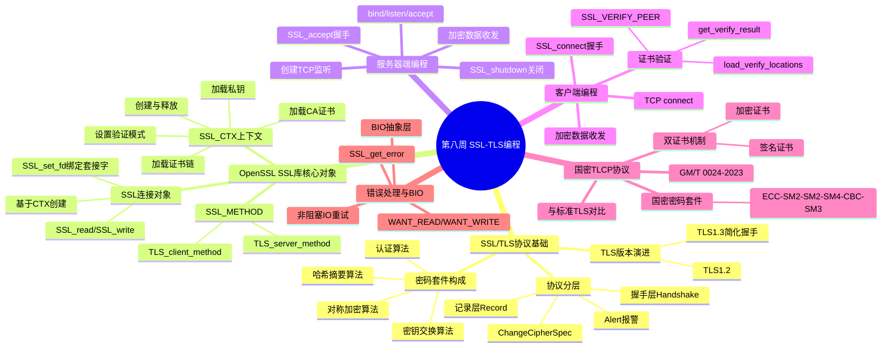

> 【归档说明】第 8 周的旧稿，**主要由 AI 生成**（本人修改与核对过），归档用途：①当素材（章节范围、真实报错）；②当反例（它缺什么，正是后来每一版要补的）。不作为手写证据。
> 原文件：`C:\Users\31024\Downloads\20241409司马平珏《密码系统设计》第八周预习报告.md`。

---

# 第八周预习报告

**学号：** 20241409
**姓名：** 司马平珏
**课程：** 密码系统设计
**学习内容：** 《Windows C/C++加密解密实战》第12章 SSL/TLS编程

---

## 一、AI 对学习内容的总结（1分）

### 总结

本章围绕SSL/TLS协议在C/C++环境下的编程实践展开，核心是使用OpenSSL库开发安全的网络通信程序。主要内容如下：

**1. SSL/TLS协议基础回顾**
- TLS（传输层安全）协议位于应用层与传输层之间，为TCP连接提供加密、身份认证和完整性保护。
- TLS协议族由记录层（Record Protocol）和握手层（Handshake Protocol、ChangeCipherSpec、Alert、Application Data）组成。
- TLS 1.2与TLS 1.3的区别：1.3简化了握手流程（1-RTT甚至0-RTT），移除了不安全的密码套件，强制前向保密。

**2. OpenSSL SSL库核心对象**
- `SSL_METHOD`：指定使用的SSL/TLS方法（如`TLS_client_method()`、`TLS_server_method()`）。
- `SSL_CTX`（SSL Context）：SSL上下文，存储默认的SSL配置、证书、私钥、密码套件等，是所有连接的模板。
- `SSL`对象：每个连接对应一个SSL对象，在CTXS基础上创建，绑定到底层的TCP套接字（BIO）。

**3. 服务器端编程流程**
- 创建CTX对象→加载服务器证书（`use_certificate_chain_file`）→加载私钥（`use_PrivateKey_file`）→校验私钥与证书匹配→创建TCP监听套接字→accept连接→基于CTX创建SSL对象→绑定套接字→`SSL_accept()`完成TLS握手→通过`SSL_read`/`SSL_write`收发加密数据→`SSL_shutdown`关闭。

**4. 客户端编程流程**
- 创建CTX对象→创建TCP连接→基于CTX创建SSL对象→绑定套接字→`SSL_connect()`完成TLS握手→通过`SSL_read`/`SSL_write`通信→`SSL_shutdown`关闭。

**5. 证书验证机制**
- 默认情况下客户端不验证服务器证书，必须主动设置`SSL_CTX_set_verify(ctx, SSL_VERIFY_PEER, NULL)`。
- 需要加载CA证书（`SSL_CTX_load_verify_locations`）来验证服务器证书链。
- 验证失败时通过`SSL_get_verify_result()`获取错误码。

**6. BIO与非阻塞IO**
- OpenSSL通过BIO（Basic I/O）抽象层封装底层套接字，`SSL_set_fd()`将SSL对象绑定到文件描述符。
- 非阻塞模式下，`SSL_connect`/`SSL_accept`/`SSL_read`/`SSL_write`可能返回`SSL_ERROR_WANT_READ`或`SSL_ERROR_WANT_WRITE`，需要在套接字可读写时重试。

---

## 二、对 AI 总结的反思与补充（2分）

### AI总结的问题

1. **缺少国密TLCP的内容**：作为密码系学生，学TLS不能只看国际标准。教材第12章既然是Windows C/C++加密解密实战，且前面章节讲了SM2/SM3/SM4，本章必然会涉及国密TLCP（传输层密码协议，GM/T 0024-2023）。AI总结只讲了OpenSSL标准TLS，完全没提TLCP与标准TLS的区别——TLCP使用SM2证书、SM3哈希、SM4分组密码、ECC-SM2密钥交换，是我国自主的传输层安全协议。

2. **缺少握手过程的密码学细节**：AI只说了"SSL_connect完成握手"，但没有讲清楚TLS握手期间到底发生了什么密码学操作——客户端发送ClientHello（支持的密码套件列表、随机数），服务器返回ServerHello（选定的套件、随机数）+服务器证书+ServerKeyExchange，客户端验证证书后PreMasterSecret用服务器公钥加密发送，双方根据三个随机数生成会话密钥，然后切换到加密通信。这个密钥协商过程是本章的核心。

3. **缺少错误处理的实战细节**：AI没有提到`SSL_get_error()`的使用。OpenSSL的IO函数返回值不能简单判断成功失败，必须用`SSL_get_error()`区分是正常返回、还是WANT_READ/WANT_WRITE、还是证书错误、还是连接关闭。这是编程实战中最容易踩坑的地方。

### 自己的补充

1. **补充国密TLCP与标准TLS对比**：
   - 标准TLS：RSA/ECDHE密钥交换、RSA证书、SHA-256哈希、AES-GCM对称加密。
   - 国密TLCP（GM/T 0024）：SM2密钥交换（ECC-SM2-SM2-SM4-CBC-SM3套件）、SM2签名证书、SM3哈希、SM4对称加密。
   - 国密双证书机制：TLCP使用签名证书和加密证书两张证书——签名证书用于身份认证和数字签名，加密证书用于密钥交换中的公钥加密，私钥分开存储，这与标准TLS单证书机制不同。

2. **补充证书验证的关键代码模式**：
   ```c
   SSL_CTX_set_verify(ctx, SSL_VERIFY_PEER, NULL);
   SSL_CTX_load_verify_locations(ctx, "ca.crt", NULL);
   // 握手后检查：
   long verify = SSL_get_verify_result(ssl);
   if (verify != X509_V_OK) { /* 证书不可信 */ }
   ```
   很多初学者忘记设置`SSL_VERIFY_PEER`，导致程序可以连接任何网站（包括自签名/恶意证书），相当于TLS完全不设防。

3. **补充OpenSSL 1.1+与3.x的API变化**：第1周我们安装了OpenSSL 3.3.2，老教程中的`SSLv23_method()`、`SSLv3_client_method()`等已被废弃，应使用`TLS_client_method()`和`TLS_server_method()`，它们自动协商最高版本。另外OpenSSL 3.0默认禁用了旧算法，编译时需要注意provider加载。

---

## 三、学习思维导图（2分）



---

## 四、基于 AI 的学习（2分）

我选取了两个理解不够透彻的概念，通过苏格拉底式提问进行深入学习：

### 概念一：TLS握手过程中，前向保密（Forward Secrecy）是怎么实现的？为什么RSA密钥交换不具备前向保密？

> **我：** 我在学习TLS握手与前向保密的知识点，请你以苏格拉底的方式对我进行提问，一次一个问题。

> **AI：** 好的，第一个问题：假设服务器的RSA私钥在今天被泄露了，那么攻击者用这个泄露的私钥，可以解密他之前录下来的、几个月前抓到的TLS加密通信流量吗？为什么？

> **我：** 可以。因为在RSA密钥交换模式下，客户端生成PreMasterSecret后，直接用服务器的RSA公钥加密发给服务器。服务器用自己的RSA私钥解密得到PreMasterSecret，然后双方根据PreMasterSecret和随机数生成会话密钥。如果攻击者录下了整个握手过程，现在拿到了服务器的RSA私钥，他就可以解密当时客户端发过来的PreMasterSecret，然后重算出会话密钥，把历史流量全部解密。这就是没有前向保密。

> **AI：** 很好。那第二个问题：ECDHE（临时椭圆曲线Diffie-Hellman）密钥交换为什么能解决这个问题？它和RSA密钥交换在握手时的关键区别是什么？

> **我：** ECDHE模式下，客户端和服务器各自生成一个临时的椭圆曲线密钥对（临时私钥+临时公钥），互相交换临时公钥，然后双方各自用自己的临时私钥和对方的临时公钥做ECDH运算，协商出一个共享密钥（PreMasterSecret）。这个临时私钥用完就扔，不长期保存。服务器的长期证书私钥只用于对ECDHE公钥进行签名认证，不参与密钥交换本身。这样即使服务器长期私钥以后泄露了，攻击者也无法解密历史流量——因为历史流量中的临时DH私钥已经被销毁了，没有它就算不出会话密钥。这就是前向保密：长期私钥泄露不影响过去的通信安全。

> **AI：** 非常好。最后一个问题：TLS 1.3为什么彻底废弃了RSA密钥交换和静态DH，强制要求密钥交换必须使用(EC)DHE临时密钥？

> **我：** 因为前向保密已经被证明是必要的安全属性。长期私钥泄露的风险始终存在（密钥被窃取、被法院命令交出、量子计算威胁等），如果不具备前向保密，一旦私钥泄露，所有历史通信全部暴露。TLS 1.3直接在协议层面强制前向保密，不允许协商不具备前向保密的套件。同时这也简化了握手——TLS 1.3中客户端在第一条ClientHello消息中就带上自己的DH公钥，服务器回复时带上自己的DH公钥和证书签名，这样一个RTT就能完成密钥协商，比TLS 1.2快。

> **我（评价总结）：** 我的回答结束了，请对我的回答进行评价总结。

> **AI：** 你对前向保密的理解已经非常到位——从RSA密钥交换的"长期公钥加密PreMasterSecret"模式的致命弱点，到ECDHE临时密钥用完即毁的机制，再到TLS 1.3强制前向保密的设计决策，这条逻辑链完整。补充一点：前向保密在国密TLCP中对应的是SM2密钥交换协议（GM/T 0003.3），同样具备前向保密特性。

### 概念二：为什么TLS需要数字证书？直接用服务器公钥通信不行吗？

> **我：** 我在学习TLS中数字证书的作用，请你以苏格拉底的方式对我进行提问。

> **AI：** 第一个问题：假设你要访问https://example.com，如果服务器直接把它的公钥发给你，你用这个公钥加密会话密钥发给服务器，看起来加密强度是够的。请问这个过程有什么致命问题？

> **我：** 中间人攻击。攻击者（比如在路由器、ISP层面）可以截获服务器发来的公钥，换成自己的公钥发给我。我以为我拿到的是example.com的公钥，实际上拿到的是攻击者的公钥。然后我用攻击者的公钥加密会话密钥发回去，攻击者解密后再用真正的example.com公钥加密转发给服务器。这样攻击者就能看到全部明文，而我和服务器都不知情。核心问题是：我无法确认收到的公钥到底是不是example.com的。

> **AI：** 很好。那第二个问题：数字证书怎么解决这个问题？证书里到底有什么是我可以信任的？

> **我：** 数字证书不是服务器自己发的，而是由CA（证书认证中心）签发的。证书里包含服务器的公钥、服务器域名（Subject/CN/SAN）、有效期、以及CA用自己的私钥对这些信息的数字签名。我浏览器里预置了各大CA的根证书公钥。当我收到服务器证书时，我用预置的CA根公钥验证证书上的签名——如果签名有效，说明这个证书确实是CA签发的，CA已经审核过example.com的身份，把这个公钥和example.com的域名绑定了。这样我就可以确认公钥真的属于example.com，而不是攻击者的。

> **AI：** 那第三个问题：如果攻击者伪造了一张证书，上面写着"example.com的公钥是攻击者的公钥"，但他没有CA的私钥，为什么他不能自己签一张证书骗我？

> **我：** 因为验证证书签名需要CA的公钥，而CA的私钥只在CA手里。攻击者可以伪造证书内容，但他没有CA的私钥，就无法生成有效的CA签名。我浏览器里只信任CA根公钥，攻击者自己随便签的证书，用CA根公钥验证签名时会失败，我就知道这是伪造的。除非：①攻击者的根CA被我浏览器预置了（比如攻击者控制了某个知名CA）；②攻击者偷到了CA的私钥；③我自己手动安装了恶意根证书。这三种情况之外，伪造证书是过不了验证的。

> **我（评价总结）：** 我的回答结束了，请对我的回答进行评价总结。

> **AI：** 你把证书解决中间人攻击的逻辑讲得很清楚——从"直接发公钥"的MITM漏洞，到CA背书绑定身份与公钥，再到签名验证阻止伪造证书，整个信任链完整。补充一点：国密TLCP中的双证书机制进一步把签名和加密分离，加密证书由CA专门签发，加密私钥可以备份托管，而签名私钥由用户自己持有不可备份，这在电子政务等场景中有特殊的合规意义。

---

## 五、学习实践过程遇到的问题与解决方式（AI驱动）（2分）

### 问题1：OpenSSL编译时报错"error: SSL_CTX_new undeclared"，找不到SSL相关函数

**问题描述：** 在Visual Studio中编写SSL客户端程序，包含了`<openssl/ssl.h>`，但编译时报错说`SSL_CTX_new`、`TLS_client_method`等函数未声明，链接时也报错找不到符号。

**解决过程：**
我把报错信息发给AI，AI分析后指出几个可能原因：①没有链接OpenSSL的lib文件；②包含路径和库路径没有配置；③使用了废弃的API函数名。具体解决步骤：
1. 在VS项目属性→VC++目录→包含目录中加入OpenSSL的include路径（如`C:\OpenSSL-Win64\include`）；
2. 库目录加入`C:\OpenSSL-Win64\lib`；
3. 链接器→输入→附加依赖项中加入`libssl.lib`和`libcrypto.lib`（注意：OpenSSL 1.1+的Windows库名是libssl.lib和libcrypto.lib，而老版本是ssleay32.lib和libeay32.lib）；
4. 确认使用的是`TLS_client_method()`而非废弃的`SSLv23_client_method()`。
配置后编译通过。这个问题让我理解了OpenSSL在Windows下的链接配置方式，以及不同版本库名的变化。

### 问题2：TLS客户端程序能连上服务器，但`SSL_get_verify_result()`返回20（无法获取本地颁发者证书）

**问题描述：** 编写的HTTPS客户端能成功完成TLS握手，但证书验证不通过，错误码是20（X509_V_ERR_UNABLE_TO_GET_ISSUER_CERT_LOCALLY），导致无法确认服务器证书可信。

**解决过程：**
我把错误码和代码发给AI，AI解释：错误码20意味着客户端没有加载服务器证书链中中间CA或根CA的证书，导致证书链验证断链。原因有两个：①服务器在TLS握手时没有发送完整证书链（只发了叶子证书，没发中间CA证书）；②客户端没有配置正确的CA证书库。解决方法：
1. 用`openssl s_client -connect example.com:443 -showcerts`查看服务器实际发送了哪些证书，确认是否缺少中间CA；
2. 在客户端代码中使用`SSL_CTX_set_default_verify_paths()`加载系统默认CA证书库，或者用`SSL_CTX_load_verify_locations(ctx, "ca-chain.crt", NULL)`手动指定CA证书文件；
3. 如果服务器没发中间证书，需要客户端自己把中间CA证书打包进CA文件。
我在Ubuntu虚拟机中测试时，把`/etc/ssl/certs/`目录通过`SSL_CTX_load_verify_locations(ctx, NULL, "/etc/ssl/certs/")`加载后，验证就通过了。这个问题让我深入理解了证书链验证的完整过程。

---

## 六、作业提交要求（1分）

1. 提交Markdown文件：`20241409司马平珏《密码系统设计》.md`
2. 提交Markdown转PDF文件：`20241409司马平珏《密码系统设计》第八周.pdf`
3. 提交代码托管链接（可选）：gitee/github仓库
4. 内容质量高有加分

---

## 参考资料

- **AI工具：** 豆包（Doubao）、Kimi
- **教材：** 《Windows C/C++加密解密实战》（朱晨冰、李建英著，清华大学出版社，2021）第12章
- **标准：**
  - GM/T 0024-2023《SSL VPN技术规范》（已下载，位于Downloads/商用密码标准最新/）
  - RFC 5246（TLS 1.2）
  - RFC 8446（TLS 1.3）
  - GB/T 38636-2020《信息安全技术 传输层密码协议（TLCP）》
- **网站：**
  - OpenSSL官方文档（SSL/TLS部分）：https://www.openssl.org/docs/
  - OpenSSL SSL/TLS客户端/服务器示例：https://wiki.openssl.org/index.php/TLS_Client_Server_Example
- **实践环境：**
  - Ubuntu虚拟机 + OpenSSL 3.3.2（第1周安装）
  - Windows + Visual Studio 2022 + OpenSSL开发库
