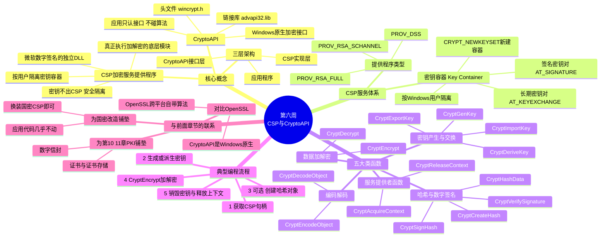

> 【归档说明】第一周的手写原稿已丢失（电脑重装），这里放的是**第六周已提交的报告原稿**，
> 作为"人手写一份报告要花多少力气、会漏什么"的替代证据。它不是第一周，也不是防作弊条款里
> 那份"禁止 AI 的第 1 次手工作业"——那份确实找不回来了，如实记录在此，不做补写。
> 原文件：`C:\Users\31024\Downloads\20241409司马平珏《密码系统设计》第六周.md`（288 行）。

---
# 密码系统设计

## 第六周预习报告

**姓名：** 司马平珏
**学号：** 20241409
**院系：** 北京电子科技学院 密码系
**指导教师：** 娄嘉鹏
**学习内容：** 《Windows C/C++加密解密实战》第9章 CSP和CryptoAPI

---

## 一、学习内容

本周学习《Windows C/C++加密解密实战》第9章——CSP和CryptoAPI，对应教材页码约第350页起。本章是在前面已经学完对称加密（SM4/DES/AES）、杂凑函数（SM3/SHA）、编码格式（Base64/PEM/ASN.1）、RSA非对称加密、数字签名、椭圆曲线ECC等具体算法之后，转向"Windows平台如何统一组织和调用这些算法"的一章，属于从"算法原理"到"工程框架"的过渡章节。

本章主要包含以下小节：

- 9.1 什么是CSP
- 9.2 CryptoAPI简介
- 9.3 CSP服务体系
- 9.4 CSP的组成
- 9.5 CryptoAPI体系结构
- 9.6 CryptoAPI调用底层CSP服务方式
- 9.7 CryptoAPI的基本功能
- 9.8 搭建CryptoAPI开发环境
- 9.9 基本加密函数
  - 9.9.1 服务提供者函数
  - 9.9.2 密钥的产生和交换函数
  - 9.9.3 编码/解码函数
  - 9.9.4 数据加密/解密函数
  - 9.9.5 哈希和数字签名函数

---

## 二、AI对学习内容的总结（1分）

> 本节内容由AI（豆包）阅读第9章目录与相关资料后整理而成，用于建立本章的整体框架认知。

本章核心讲的是Windows操作系统下的两套东西：**CSP（Cryptographic Service Provider，加密服务提供程序）**和**CryptoAPI**。

**第一，CSP是什么。** CSP是Windows真正执行加解密运算的底层模块，它是一个经过微软数字签名的独立程序（通常是一个DLL加上一个签名文件）。所有真正的密钥生成、随机数产生、加解密运算都在CSP内部完成，应用程序自己碰不到原始密钥。微软这样设计是为了安全：即使应用程序被攻破，密钥也留在CSP里出不来。

**第二，CryptoAPI是什么。** CryptoAPI是微软给应用程序提供的一套函数接口（在wincrypt.h头文件里），应用程序通过调用这些函数，间接地让CSP干活。应用程序只需要记住`CryptAcquireContext`、`CryptGenKey`、`CryptEncrypt`这些函数名，不用管底下是哪家CSP、用的是什么算法。这就形成了一个三层结构：**应用程序 → CryptoAPI → CSP**。

**第三，CSP的服务体系。** CSP里有一个很重要的概念叫"密钥容器（Key Container）"。密钥不是随便放在内存里的，而是按用户、按容器名存放在CSP内部。同一个CSP可以有多个密钥容器，每个容器里可以存几对长期密钥（如签名密钥对、交换密钥对）。应用程序第一次使用时，可以用`CryptAcquireContext`配合`CRYPT_NEWKEYSET`标志创建一个新的密钥容器。

**第四，CryptoAPI的函数分类。** 教材9.9节把函数分成五类：
1. 服务提供者函数：负责获取和释放CSP句柄，代表函数是`CryptAcquireContext`和`CryptReleaseContext`；
2. 密钥产生与交换函数：如`CryptGenKey`（随机生成密钥）、`CryptDeriveKey`（从口令派生密钥）、`CryptImportKey`/`CryptExportKey`（导入导出密钥）；
3. 编码解码函数：处理ASN.1/DER格式，如`CryptEncodeObject`、`CryptDecodeObject`；
4. 数据加解密函数：`CryptEncrypt`和`CryptDecrypt`；
5. 哈希与数字签名函数：`CryptCreateHash`、`CryptHashData`、`CryptSignHash`、`CryptVerifySignature`。

**第五，典型编程流程。** 用CryptoAPI做一次对称加密，基本套路是：先用`CryptAcquireContext`拿到CSP句柄 → 用`CryptGenKey`或`CryptDeriveKey`生成会话密钥 → 如果需要先做哈希就用`CryptCreateHash`+`CryptHashData` → 调用`CryptEncrypt`加密数据 → 用完后`CryptDestroyKey`销毁密钥句柄、`CryptReleaseContext`释放CSP。开发时需要在Visual Studio中包含头文件`wincrypt.h`，并链接`advapi32.lib`。

---

## 三、对AI总结的反思与补充（2分）

> 本节是在AI总结的基础上，自己对照教材和实际开发经验做的补充与纠偏。

**AI总结的问题：**

1. **AI总结偏"骨架"，漏掉了CSP最关键的安全意义。** AI只说"CSP是底层模块"，但没有讲清楚微软为什么要费这一层周折。结合教材9.1和9.3节，CSP的核心设计思想其实是"密钥与应用程序隔离"：私钥永远不离开CSP，应用程序拿到的只是一个句柄（HCRYPTKEY），而不是密钥本身。这和我们第6、7章在OpenSSL里直接把RSA私钥读进内存变量的做法完全不同。这一点对做密码系统设计的人来说是本质区别，必须点出来。

2. **AI没有讲"提供程序类型（Provider Type）"这个概念。** 教材9.3节提到，CSP是按类型划分的，比如`PROV_RSA_FULL`是最常用的全功能RSA提供程序，`PROV_DSS`只做DSS签名，`PROV_RSA_SCHANNEL`专门给TLS/SSL用。`CryptAcquireContext`的第二个参数`dwProvType`就是用来指定这个类型的。选错了类型，后面想要的算法就用不了。这是实际编程中非常容易踩的坑。

3. **AI对"密钥容器"的解释不够具体。** 补充一下：密钥容器是按Windows用户账户隔离的，也就是说同一个CSP，A用户登录后看到的密钥容器和B用户看到的不是同一个。这就是为什么很多加密程序换个用户登录就报"密钥集不存在"——不是密钥丢了，是跑到另一个用户的容器里去了。

4. **关于编程流程，AI少了一步很重要的东西：会话密钥与公钥密钥的区别。** 在CryptoAPI里，`CryptGenKey`传`AT_KEYEXCHANGE`或`AT_SIGNATURE`产生的是长期公钥密钥对（存在容器里），传`CALG_RC4`、`CALG_AES`等算法ID产生的是一次性会话密钥。加密文件时一般先用会话密钥加密数据，再把会话密钥用接收方公钥包起来——这就是后面第10、11章要讲的数字信封的雏形。

**自己的补充：**

- 把本章和前面章节串起来看：OpenSSL是一套跨平台、自带算法库的"大而全"方案；而CryptoAPI+CSP是Windows"原生"的方案，它把算法实现藏在系统里，应用层只认接口。两套体系在工程上是并存的，做Windows桌面软件经常两套都要碰。
- 从密评（密码应用安全性评估）的角度理解CSP：CSP相当于把密码运算收敛到一个经过认证的模块里，这正好符合"密码设备/密码模块要合规"的要求。国密场景下，Windows上可以安装支持SM2/SM3/SM4的国密CSP，应用程序代码几乎不用改，只换一个CSP就能完成国密改造——这就是分层架构的工程价值。

---

## 四、学习思维导图（2分）

> 使用Mermaid MindMap语法绘制，可在VS Code（Markdown Preview Mermaid Support插件）或在线Mermaid Live Editor中预览渲染。



渲染效果参考：根节点为"第六周 CSP与CryptoAPI"，向外分出"核心概念""CSP服务体系""五大类函数""典型编程流程""与前面章节的联系"五大主分支，每个分支再向下展开具体知识点。

---

## 五、基于AI的学习（2分）

> 本周挑选了两个理解起来容易混淆的概念，用苏格拉底式提问的方式和AI对答，下面是问答记录与我的思考。

### 概念一：CSP的"密钥容器"到底解决了什么问题？

**我：** 我在学习CSP的密钥容器这个知识点，请你以苏格拉底的方式对我进行提问，一次一个问题。

**AI：** 好的。先问你第一个问题：既然应用程序自己也能在内存里生成和保存密钥，为什么Windows非要搞一个"密钥容器"，把密钥藏到CSP里面去？

**我：** 我觉得主要是为了防止密钥被偷。如果密钥直接放在应用程序的内存里，攻击者只要dump一下进程内存，或者在应用程序里埋个钩子，就能把私钥偷出来。而放在CSP里，应用程序拿到的只是一个句柄，真正的密钥材料CSP自己保管，应用程序再想拿也拿不到。

**AI：** 方向对了。那我再追问一句：就算密钥藏在CSP里，应用程序总得让CSP"用这个密钥去签名"吧？这时候CSP内部到底是怎么"用"密钥的，应用程序有没有机会在这个过程中把密钥读走？

**我：** 应该没有机会。应用程序调用`CryptSignHash(hKey, ...)`的时候，传进去的是哈希值和句柄，CSP在自己内部完成签名，把签名结果返回给应用程序。整个过程应用程序只是"发指令"，私钥从头到尾没有出现在应用程序的地址空间里。

**AI：** 那你再想想，密钥容器是按"机器"存还是按"用户"存？这会带来什么实际后果？

**我：** 按用户存。后果就是：同一个程序，管理员账户能找到密钥，切到普通用户账户就找不到了，因为密钥容器是跟着Windows登录用户走的。这也是为什么实际开发中经常要用`CryptAcquireContext`配合`CRYPT_MACHINE_KEYSET`标志来指定机器级容器，否则服务程序在不同会话里会找不到密钥。

**AI：** 针对我"密钥容器"这个知识点，你觉得我理解了吗？

**我：** 我觉得基本理解了。核心就是三点：私钥不出CSP、句柄代替密钥、容器按用户隔离。

**AI：** 我的评价总结：你抓住了本质。密钥容器的意义不是"把密钥存到硬盘上"那么简单，而是建立了一个"密钥不出安全边界"的信任模型。这也是为什么Windows上做数字签名、USB Key、智能卡，都可以通过实现一个CSP插进来——因为CSP这个接口把"密钥在哪、怎么保护"这件事和应用程序完全解耦了。

### 概念二：为什么要有CryptoAPI这一层，不能让应用程序直接调CSP吗？

**我：** 第二个概念：为什么需要CryptoAPI这一层？请继续苏格拉底式提问。

**AI：** 好。假设微软不做CryptoAPI，而是让每个应用程序直接去加载CSP的DLL、直接调用CSP导出的函数，你觉得会出什么问题？

**我：** 那每个应用程序都得自己知道CSP的DLL叫什么、导出函数长什么样。今天换一家CSP厂商，所有应用程序都得改代码。而且不同CSP厂商的函数命名、参数格式都不一样，应用程序就没法通用了。

**AI：** 那加了CryptoAPI这层以后，应用程序看到的是什么？

**我：** 看到的是一套统一的函数，比如`CryptEncrypt`，不管底下接的是微软自带的CSP，还是国产的国密CSP，还是某个USB Key厂商的CSP，应用程序代码都一样。换CSP只需要在系统里换一个提供程序，应用程序一行代码都不用改。

**AI：** 这和我们之前学的OpenSSL的EVP接口思想是不是有点像？

**我：** 非常像。OpenSSL的EVP也是"算法无关"的高层接口，底层可以换AES、SM4、ChaCha20。CryptoAPI之于CSP，就相当于EVP之于OpenSSL的各种算法实现——都是一个抽象层，把"用什么算法"和"怎么用算法"分开。

**AI：** 那你能不能用一句话总结分层的好处？

**我：** 分层让"算法可替换、密钥可保护、应用可复用"，安全升级和密码替换不需要动业务代码。

**AI：** 我的评价总结：你已经抓住了密码工程框架设计的核心思想——接口与实现分离。本章虽然看似在讲Windows API，但背后的设计思想是通用的，以后碰到Java JCE、Java Card PKCS#11、国密GM/T 0018接口，都是同一个套路。

---

## 六、学习实践过程遇到的问题与解决方式（2分）

> 本周在VS2022里照着教材9.8、9.9节写了一个调用CryptoAPI获取CSP上下文并测试MD5哈希的小程序，过程中遇到下面两个问题，均通过AI工具和查微软文档解决。

### 问题一：编译时报 LNK2019 无法解析的外部符号 CryptAcquireContext

**现象：** 在Visual Studio里写完`CryptAcquireContext`、`CryptCreateHash`这些函数后，头文件`wincrypt.h`也包含了，但一编译就报错：

```
error LNK2019: 无法解析的外部符号 __imp__CryptAcquireContextA@20
error LNK2019: 无法解析的外部符号 __imp__CryptCreateHash@20
```

**排查过程：** 一开始我以为是头文件路径没配对，但`#include <wincrypt.h>`是能找到的，说明编译阶段没问题，问题出在链接阶段。我把报错关键词"CryptAcquireContext LNK2019"丢给AI，AI告诉我：CryptoAPI的实现并不在kernel32里，而是在`advapi32.dll`里，需要在工程里手动链接`advapi32.lib`。

**解决方式（两种任选其一）：**

方式一：在代码最上面加一行：
```c
#pragma comment(lib, "advapi32.lib")
```

方式二：在Visual Studio中右键项目 → 属性 → 链接器 → 输入 → 附加依赖项，加上`advapi32.lib`。

加上之后重新编译，LNK2019立刻消失。这个坑的本质是：Win32 API里，Kernel32.dll默认自动链接，但advapi32.dll、user32.dll这些需要自己显式链接。

### 问题二：CryptAcquireContext 返回 FALSE，GetLastError 报 NTE_BAD_KEYSET

**现象：** 链接错误解决后运行程序，`CryptAcquireContext`直接返回FALSE，用`GetLastError()`查到错误码是`NTE_BAD_KEYSET`（0x80090016）。

**排查过程：** 查微软文档后知道，这个错误的意思是"指定的密钥容器不存在"。我代码里第一次跑，当然没有现成的密钥容器。AI提示：`CryptAcquireContext`的`dwFlags`参数如果传0，就是去打开一个已存在的容器；要新建容器，需要传`CRYPT_NEWKEYSET`。

**解决方式：** 把第一次调用写成下面这样，先尝试打开，失败了就新建：

```c
HCRYPTPROV hProv = 0;
// 先尝试打开已存在的密钥容器
if (!CryptAcquireContext(&hProv, NULL, MS_ENHANCED_PROV,
                        PROV_RSA_FULL, 0))
{
    if (GetLastError() == NTE_BAD_KEYSET)
    {
        // 容器不存在，新建一个
        if (!CryptAcquireContext(&hProv, NULL, MS_ENHANCED_PROV,
                                PROV_RSA_FULL, CRYPT_NEWKEYSET))
        {
            printf("新建密钥容器失败，错误码：%d\n", GetLastError());
            return -1;
        }
        printf("密钥容器新建成功\n");
    }
    else
    {
        printf("获取CSP上下文失败，错误码：%d\n", GetLastError());
        return -1;
    }
}
```

再跑一次，程序正常输出"CSP句柄获取成功"，后面的`CryptCreateHash`、`CryptHashData`、`CryptGetHashParam`也都顺利跑通，成功算出了一段测试字符串的MD5哈希值。这个问题让我真正理解了教材9.3节讲的"密钥容器"不是一个抽象概念，而是一个实实在在、第一次用必须创建的东西。

---

## 七、作业提交要求（1分）

1. 提交Markdown文件，文档命名"学号姓名《密码系统设计》第六周.md"，即本文件：`20241409司马平珏《密码系统设计》第六周.md`。
2. 提交Markdown转PDF版本，命名"20241409司马平珏《密码系统设计》第六周.pdf"，使用VS Code的Markdown PDF插件导出。
3. 代码托管链接（可选）：本周的CryptoAPI测试代码后续上传至Gitee仓库。
4. 内容严格按照教材第9章组织，结合AI辅助学习记录、思维导图、调试问题记录三部分展开。

---

## 八、参考资料

**AI工具：**
- 豆包（字节跳动）：用于章节总结、苏格拉底式提问、LNK2019与NTE_BAD_KEYSET问题排查
- Microsoft Learn 官方文档：CryptoAPI函数参考

**图书：**
- 朱晨冰、李建英.《Windows C/C++加密解密实战》. 清华大学出版社，2021.（第9章 CSP和CryptoAPI）

**网站：**
- Microsoft Learn - Cryptographic Service Provider Contexts：https://learn.microsoft.com/zh-cn/windows/win32/seccrypto/cryptographic-service-provider-contexts
- Microsoft Learn - CryptAcquireContextW：https://learn.microsoft.com/zh-cn/windows/win32/api/wincrypt/nf-wincrypt-cryptacquirecontextw
- OpenSSL 官方文档（对比EVP抽象层思想）
