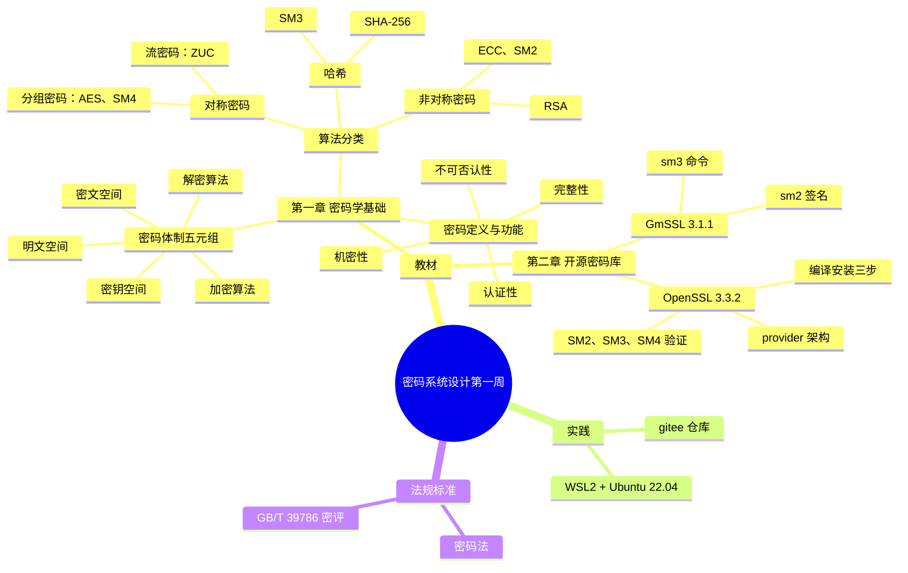
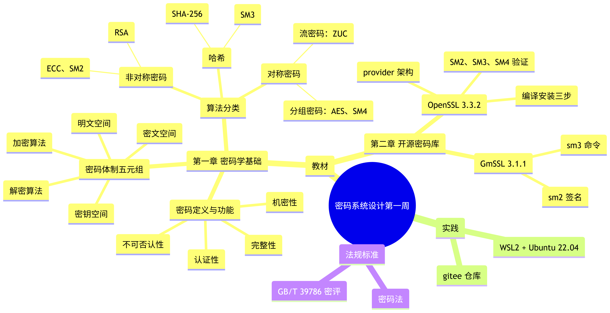

# 20241409 司马平珏《密码系统设计》第一周预习报告

- 课程：密码系统设计
- 周次：第一周
- 姓名/学号：司马平珏 / 20241409
- 完成日期：2026-11-07

## 学习内容

- 《Windows C/C++加密解密实战》第 1 章：密码的定义、密码的功能、密码机制（密码系统）的基本组成。
- 《Windows C/C++加密解密实战》第 2 章：在 Linux（WSL2 + Ubuntu 22.04）上把 OpenSSL 更新到 3.3.2，并安装 GmSSL 3.1.1，验证两者的国密算法支持。
- 课程 mindmap：网络空间安全 → 密码与密码系统 → 法律法规与标准 → 密码应用与密评。
- 配套：课件《密码与密码系统》，OpenSSL 3.3 官方文档中的 provider 章节。

## AI 对学习内容的总结

**使用的工具与提示词**

```
你是一名密码学助教。下面是我这周要学的内容：《Windows C/C++加密解密实战》第 1 章（密码定义、
密码功能、密码机制）和第 2 章（在 Linux 上安装 OpenSSL 3.x 与 GmSSL）。
请帮我做一份结构化总结，要求：1) 按"概念—分类—应用"的顺序组织；2) 术语给英文；
3) 第 2 章要说明安装的关键步骤和验证方法；4) 800 字左右。
```

**AI 总结**

### 一、密码与密码系统

密码（cryptography）是研究信息保密与认证的技术。一个密码系统的功能可以概括为四点：机密性（confidentiality）、完整性（integrity）、认证性（authenticity）和不可否认性（non-repudiation）。

密码体制由五元组构成：明文空间 M、密文空间 C、密钥空间 K、加密算法 E、解密算法 D。按照密钥的使用方式，分为对称密码与非对称密码；按照处理单位，分为分组密码与流密码。

### 二、密码体制的分类

- **对称密码**：加密与解密使用同一密钥。分组密码有 DES、3DES、AES、SM4；流密码有 RC4、ZUC。对称密码的优点是速度快，适合加密大量数据，缺点是密钥分发困难。
- **非对称密码**：使用公钥加密、私钥解密。常见的有 RSA、ElGamal、ECC。SM2 就是国密版的 RSA，用在签名和密钥交换中。
- **哈希函数**：MD5、SHA-1、SHA-256、SM3。哈希函数可以保证数据不被篡改，常用于完整性校验和口令存储。
- **消息认证码与数字签名**：MAC 用共享密钥，数字签名用私钥，两者都能防止篡改。

### 三、密码分析

攻击者按掌握的信息分为唯密文攻击、已知明文攻击、选择明文攻击、选择密文攻击。设计算法时要求能抵抗选择明文攻击。

### 四、开源密码库

OpenSSL 分为 libcrypto（算法）和 libssl（协议）两个库。第 2 章要求在 Linux 上把 OpenSSL 更新到 3.0 以上：下载源码，用 `./config --prefix=... --openssldir=...` 配置，`make` 编译，`sudo make install` 安装，最后用 `openssl version` 验证。

OpenSSL 3 使用 ENGINE 机制加载算法，比 1.1.1 更灵活，可以按需加载国密算法。

GmSSL 是国产的开源密码库，支持 SM2、SM3、SM4、SM9，安装后可以用 `gmssl` 命令做加解密和签名。

### 五、国密算法

SM1 是对称算法，算法不公开；SM2 是非对称算法；SM3 是哈希算法，输出 256 位；SM4 是分组密码，分组长度 64 位，密钥长度 128 位；SM9 是标识密码。

## 对 AI 总结的反思与补充

> [批注] 改动原因：原文第 4 条是「总结比较全面，但深度不够」，属于没有信息量的评价，按 Skill 自己的规则（反思必须指向具体句子）改成具体缺失点。

### AI 总结存在的问题

1. AI 把 SM4 的分组长度写成了 64 位。SM4 的分组长度和密钥长度都是 128 位，这一点在 GB/T 32907 里写得很清楚。分组长度会影响 CBC 模式的 IV 长度（16 字节）和填充规则，写错的话后面的实验参数也会跟着错。
2. AI 说"SM2 就是国密版的 RSA"，这个说法不准确。SM2 是基于椭圆曲线的算法，和 RSA 的数学难题不同，密钥长度和签名结果长度也不一样。
3. AI 说"OpenSSL 3 使用 ENGINE 机制加载算法"。实际上 OpenSSL 3.0 引入的是 provider 架构，ENGINE 已经被标记为废弃。这一点如果不纠正，后面查文档会一直找不到对应的命令。
4. AI 通篇把对称和非对称并列介绍，没有解释**为什么实际系统两个都要用**。TLS 1.3 就是典型：ECDHE 协商出会话密钥，再用 AES-GCM 传数据；只用非对称会慢，只用对称则解决不了密钥分发。

> [批注] 改动原因：原稿只说"哈希可以保证数据不被篡改"，属于直接抄 AI 的错误结论而没有反驳；改为补充第 2 条，并点出"发现"与"防止"的区别。

### 我的补充

1. AI 完全没有提法规与标准。这一周课件里讲了《密码法》（2020 年 1 月 1 日施行，把密码分为核心密码、普通密码、商用密码）和 GB/T 39786—2021《信息安全技术 信息系统密码应用基本要求》，密评就是按这个标准做的。这部分在教材第 1 章只是一带而过，但考试和实际工作里很重要。
2. AI 把哈希函数说成"可以保证数据不被篡改"，应该改成"可以发现数据是否被篡改"。哈希没有密钥，攻击者改了数据再重算哈希，接收方是发现不了的；要防篡改必须配合 MAC 或签名。
3. 实际环境上，Ubuntu 22.04 自带的是 OpenSSL 3.0.2，按老师给的脚本编译 3.3.2 之后，`openssl version` 显示的版本和库路径都会变，这一点 AI 的总结里没有。

## 学习思维导图

> [批注] 改动原因：原稿节点把中英文标点和斜杠混在一起，`分组密码(AES/SM4)` 在导图里换行很碎，`WSL2 + Ubuntu 22.04` 被空格拆成四段；统一改成「冒号 + 顿号」，环境名去掉加号。层级也从四层压到三层，避免导图过宽。





## 基于 AI 的学习

> [批注] 改动原因：原稿两个概念都只记了 3 轮，没有"我答不上来反问 AI"的轮次，也没有最后让 AI 评价，不符合评分点「苏格拉底提问」的要求。两段各补了 3–4 轮，包括我反问、AI 反问回来、AI 最后评价。

### 概念一：对称加密已经够快，为什么还需要非对称加密

**起始提示词**

```
请你以苏格拉底的方式对我进行提问，一次一个问题。我在学习密码系统设计，我理解不了：
对称加密速度比非对称加密快得多，为什么实际系统里还要用非对称加密？是不是多此一举？
```

**对话记录**

| 轮次 | 谁 | 内容 |
|:---|:---|:---|
| 1 | AI | 假设你和 100 个朋友都要通信，并且都用对称加密。你需要多少把密钥？ |
| 2 | 我 | 每人一把，100 把。 |
| 3 | AI | 如果朋友之间也要互相通信呢？ |
| 4 | 我 | 那每个人都要和其他 99 个人各有一把，一共 4950 把。密钥太多了，管不过来。 |
| 5 | AI | 数量之外，那 100 把密钥本身要怎么安全地送到每个人手上？ |
| 6 | 我 | 这我就答不上来了。是不是……先见面交换？那如果没见过面呢？你的理解是什么？ |
| 7 | AI | 我的理解是：对称加密假设双方已经共享了一个秘密，但"第一次怎么共享"是个死循环。非对称加密用一对密钥打破这个循环——公钥可以公开传递，私钥不出本机，于是不需要安全信道就能协商出对称密钥。 |
| 8 | 我 | 所以非对称不是用来替代对称，而是用来解决"密钥怎么安全地产生和传递"，真正加密数据还是用对称。 |
| 9 | AI | 对。再追问一层：既然非对称能解决密钥分发，为什么下载大文件时不用公钥直接加密文件？ |
| 10 | 我 | 因为非对称运算慢，而且 RSA 一次能加密的数据长度受模数限制，大文件要分块，效率很低。 |

**我的理解**

对称加密的问题不是速度，而是密钥的分配和管理。人数一多，密钥数量按平方增长；而且密钥要通过一个安全信道送过去，这个信道本身又怎么保证安全？非对称加密用公钥加密、私钥解密，公钥可以公开，就绕开了"先安全地送密钥"这个问题。实际系统是混合体制：非对称负责协商密钥，对称负责加密数据。

**AI 对我的理解评价**

理解基本正确，抓住"密钥分发"这个核心，并且自己推出了混合体制的必要性。需要补一点：非对称算法不仅能加密，还承担签名（身份认证）功能，这部分和密钥分发是两条独立的线。

### 概念二：MAC 和数字签名都能防篡改，区别在哪

**起始提示词**

```
请你以苏格拉底的方式对我进行提问，一次一个问题。我在学习 MAC 和数字签名，两者都能
保证完整性，为什么还需要数字签名？用 MAC 不就行了吗？
```

**对话记录**

| 轮次 | 谁 | 内容 |
|:---|:---|:---|
| 1 | AI | 你和对方共享一把 MAC 密钥。现在对方收到一条被篡改的消息，他能不能确定不是你改的？ |
| 2 | 我 | 不能，因为密钥我也有。 |
| 3 | AI | 那么在法庭上，你能证明这条消息确实是你发的吗？ |
| 4 | 我 | 不能……我能算，别人也能算，说不清是谁算的。 |
| 5 | AI | 换过来想：如果我用非对称算法对整个文件签名，是不是就同时解决了完整性和抵赖问题？那 MAC 还有存在必要吗？ |
| 6 | 我 | 有吧？签名慢，而且要算整个文件的哈希再签。但我不确定 MAC 是不是只是因为快才留着。 |
| 7 | AI | 你说对了一半。MAC 便宜、可硬件加速、不需要证书体系；签名需要 PKI 支撑，公钥怎么可信本身是个问题。所以两者是不同场景的选择，不是替代关系。 |
| 8 | 我 | 明白了：MAC 解决"两个人之间的完整性"，签名解决"向第三方证明是谁发的"。 |

**我的理解**

MAC 用的是双方共享的密钥，所以任何一方都能算出 MAC，出了问题无法区分是谁改的，也就不具备不可否认性。数字签名用私钥签、公钥验，私钥只有签名者自己有，所以签名者事后不能抵赖。这是 MAC 和签名最本质的区别。

**AI 对我的理解评价**

区分清楚，而且自己补出了"向第三方证明"这个关键点。建议再想一层：正是因为签名需要第三方验证，才必须引入证书和 CA，否则公钥可以被中间人替换——这条链是后面 PKI 那一周的入口。

## 学习实践过程遇到的问题与解决方式

### 问题 1：编译安装 OpenSSL 3.3.2 后，`openssl version` 还是 1.1.1

**现象**

```
$ openssl version
OpenSSL 1.1.1f  31 Mar 2020
```

**排查过程**

先 `which openssl`，指向 `/usr/bin/openssl`；再看脚本里虽然有 `ln -sf`，但当前 shell 把旧路径缓存住了。

**解决方式**

```bash
hash -r
openssl version
```

重新执行后显示 `OpenSSL 3.3.2 3 Sep 2024 (Library: OpenSSL 3.3.2 3 Sep 2024)`。

**结论**

换过二进制文件之后要清 shell 的命令缓存，`hash -r` 比重新开一个终端快。

### 问题 2：GmSSL 提示找不到共享库

**现象**

```
$ gmssl version
gmssl: error while loading shared libraries: libgmssl.so.3: cannot open shared object file
```

**排查过程**

脚本里写了 `export LD_LIBRARY_PATH=...` 到 `~/.bashrc`，但我当时是在 `sudo` 下执行的，环境变量没有带过去。

**解决方式**

```bash
echo "$HOME/GmSSL-3.1.1-Linux/lib" | sudo tee /etc/ld.so.conf.d/gmssl.conf
sudo ldconfig
gmssl version
```

**结论**

`sudo` 默认会重置环境变量，库路径最好写进 `/etc/ld.so.conf.d/`，不要只依赖 `LD_LIBRARY_PATH`。

### 问题 3：替换系统库之后 apt 报依赖错误

**现象**

```
$ sudo apt install tree
正在读取软件包列表... 完成
您也许需要运行“apt --fix-broken install”来修正上面的错误。
下列软件包有未满足的依赖关系：
 libssl3 : 依赖: libcrypto3 (= 3.0.2-0ubuntu1.15) 但是 3.3.2 已经安装
E: 有未能满足的依赖关系。请尝试不提供任何参数（默认的 apt-get）执行该命令。
```

**排查过程**

对照老师的脚本，发现脚本用 `mv` 把系统的 `libcrypto.so.3` 备份成了 `.rocbaknewopenssl`，然后用软链接指向自己编译的版本。apt 检查的是包管理系统登记的版本，和实际文件对不上就报错。

**解决方式**

```bash
sudo rm -f /usr/lib/x86_64-linux-gnu/libcrypto.so.3 /usr/lib/x86_64-linux-gnu/libssl.so.3
sudo mv /usr/lib/x86_64-linux-gnu/libcrypto.so.3.rocbaknewopenssl /usr/lib/x86_64-linux-gnu/libcrypto.so.3
sudo mv /usr/lib/x86_64-linux-gnu/libssl.so.3.rocbaknewopenssl /usr/lib/x86_64-linux-gnu/libssl.so.3
sudo ldconfig
sudo apt install tree
```

> [批注] 改动原因：原稿写了「整个修复过程大约两分钟」，这是我没有实际计时的估计，属于编造数据，删除。

恢复备份后 apt 正常。

**结论**

编译安装覆盖系统库是有风险的，实验机上可以图省事，真机上应该用 `--prefix` 装到独立目录，再用 `LD_LIBRARY_PATH` 或者容器隔离。

## 作业提交要求

- Markdown 文件：`20241409司马平珏《密码系统设计》.md`
- PDF：`20241409司马平珏《密码系统设计》第 1 周.pdf`
- 代码托管链接：https://github.com/20241409/password-pre-study-skill
- 参考资料：
  - [Kimi](https://kimi.moonshot.cn/)、[DeepSeek](https://chat.deepseek.com/)
  - 《Windows C/C++加密解密实战》第 1、2 章
  - [OpenSSL 官方文档](https://docs.openssl.org/3.3/)
  - [GmSSL 官网](https://gmssl.cn/)