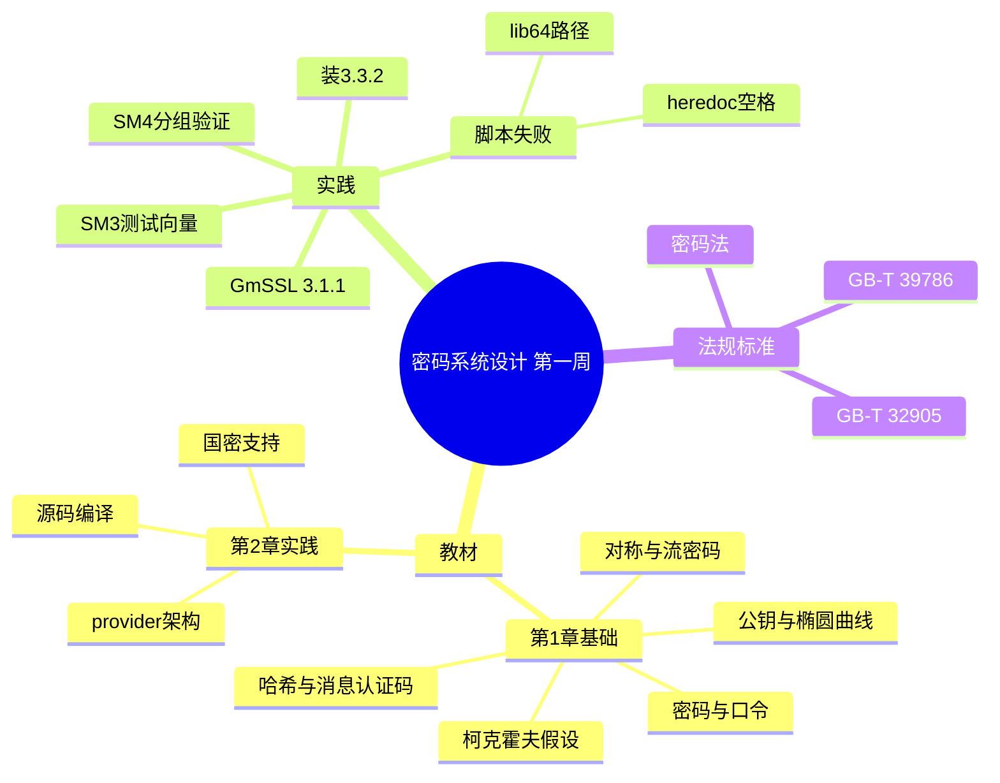
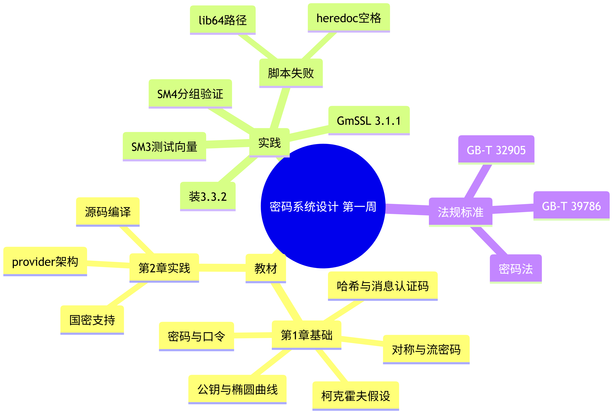

<!-- 目标字数: 8–15 行 -->

# 20241409 司马平珏《密码系统设计》第 1 周预习报告

> 生成说明：本文件由 `skill/v4/skill.md` 生成，输入卡片见附录 B。全部命令输出来自 `handmade/lab/logs/`。附录 C 是本轮新增的术语表。

## 学习内容

<!-- 目标字数: 8–15 行 -->

- 读了教材《Windows C/C++加密解密实战》第 1 章 1.1–1.4：密码学基本概念、对称密码、公钥密码、哈希函数与消息认证码。
- 读了第 2 章 2.1–2.3：OpenSSL 简介、源码目录结构、Linux 下的编译安装。
- 看了课程提供的密码系统设计思维导图（ProcessOn），对照教材补了"国密算法"这一支。
- 先把第 1 章的骨架概念抄成一张术语表（附录 C），再回读教材确认每个定义能不能用自己的话说出来。
- 在 VMware 的 Ubuntu 22.04 虚拟机上跑老师给的 `sh/opensslinstall.sh`，脚本中途失败，退出码 1。
- 查了脚本失败原因（heredoc 结束符带空格），手工修正环境变量脚本后，OpenSSL 3.2.1 可正常调用。
- 把脚本里的版本号从 3.2.1 改成 3.3.2 重新编译安装，装上作业要求的 3.3.2。
- 用 `openssl dgst -sm3` 跑 GB-T 32905 的标准测试向量，用 `openssl enc -sm4-cbc` 观察分组长度。
- 确认虚拟机上 GmSSL 已是 3.1.1，版本满足要求，未重装。
- 用 `openssl list -providers` 确认 3.x 的 provider 架构，纠正了自己"3.x 还用 ENGINE"的旧印象。

## AI 对学习内容的总结

<!-- 目标字数: 900–1300 字 -->

工具：DeepSeek，提示词如下。

```
我在学《密码系统设计》，教材是《Windows C/C++加密解密实战》。
请总结第 1 章（密码学基本概念、对称密码、公钥密码、哈希与认证）
和第 2 章（OpenSSL 简介与 Linux 下编译安装）的内容，要求：
1. 分成 5-6 个小节，每个小节 150-250 字；
2. 只讲教材里有的东西，不要扩展成通用密码学教程；
3. 不要写"综上所述""具有重要意义"这类套话；
4. 保留必要的术语英文原名。
```

### 一、密码学要解决什么问题

密码学研究的核心是：在不安全的信道上，让通信双方能够安全地交换信息。它把可读的**明文**（plaintext）通过**加密算法**和**密钥**变换成不可读的**密文**（ciphertext），接收方再用密钥还原。这里有一个基本原则叫柯克霍夫假设：系统的安全性应当只依赖于密钥的保密，而不依赖于算法的保密。换句话说，算法可以公开，密钥必须保密。

分析一个密码系统之前，还要先讲清**攻击模型**：假设攻击者手里有什么。最弱的是唯密文攻击（只拿到密文），往上是已知明文攻击（知道若干"明文—密文"对），最强的是选择明文攻击（能自己挑明文让系统加密）。同一个算法在不同攻击模型下"安全"的含义完全不同。

需要区分"密码"和"口令"这两个词。日常说的"设置密码"其实是设置**口令**（password），它是身份认证的凭据；而**密码**（cipher）指的是加密变换本身。教材在开篇就强调了这个区分，因为后面讲口令哈希存储时会反复用到。

### 二、对称密码

对称密码指加密和解密使用同一把密钥，优点是速度快，适合加密大量数据；缺点是密钥分发困难，n 个人两两通信需要 n(n-1)/2 把密钥。它又分为**分组密码**（block cipher）和**流密码**（stream cipher）。

> AI 原话｜分组密码把明文按固定长度切块，逐块加密。

典型代表是 DES（分组 64 位、密钥 56 位，已不安全）、AES（分组 128 位、密钥 128/192/256 位，目前主流）和国密的 SM4（分组 128 位、密钥 128 位）。

分组密码的设计目标可以用一对概念概括：**混淆**让密文与密钥的关系尽量复杂，**扩散**让明文的每一位影响密文的许多位。设计得好的分组密码，改动明文一个比特，密文大约有一半比特会变，这叫雪崩效应。抗穷举的能力则取决于**密钥空间**：DES 的密钥空间是 2^56，规模太小，所以今天不再使用；SM4 的密钥空间是 2^128。

分组密码还只是"一块怎么变"的规则，实际使用要配合**工作模式**，比如 ECB、CBC、CTR、GCM。ECB 模式相同的明文块会产生相同的密文块，会泄露数据结构，一般不建议使用；CBC 引入初始向量（IV）让相同明文产生不同密文；GCM 则同时提供加密和完整性校验。

### 三、公钥密码

公钥密码用一对密钥：公钥公开用于加密或验签，私钥自己保存用于解密或签名。它解决了对称密码的密钥分发问题，但速度比对称密码慢两三个数量级，所以实际系统一般用**混合密码系统**：用公钥密码传会话密钥，用对称密码传数据。

教材介绍的典型算法有 RSA（密钥一般 2048 位以上，安全性基于大整数分解难题）、ECC（常用 256 位密钥，安全性基于椭圆曲线离散对数问题）和国密的 SM2（密钥 256 位，同样基于椭圆曲线离散对数问题）。ECC 在相同安全强度下密钥短得多，256 位 ECC 大约相当于 3072 位 RSA。

> AI 原话｜SM2 是国密体系里的公钥算法，它的定位类似于 RSA。

### 四、哈希函数与消息认证码

哈希函数把任意长度输入映射成固定长度输出，要求单向性、抗碰撞性和雪崩效应。常见的有 MD5（输出 128 位）、SHA-1（输出 160 位）、SHA-256（输出 256 位），以及国密的 SM3（输出 256 位）。MD5 和 SHA-1 已经被证明存在实用碰撞攻击，不应该再用于安全场景，但很多人还在用它校验文件完整性——用来防意外损坏是可以的，防篡改不行。

哈希本身不提供来源证明，因为它谁都能算。要证明消息来自某人，需要**消息认证码**（MAC），它把密钥混进哈希，只有持有密钥的人才能算出正确的 MAC。**数字签名**则更进一步，用私钥签名、公钥验签，还能提供不可否认性。消息认证码和数字签名经常被混为一谈，区别在于 MAC 双方共享密钥，所以接收方自己也能伪造，无法向第三方证明。

### 五、OpenSSL 与工程实践

OpenSSL 是目前使用最广的开源密码库，提供 libcrypto（算法实现）和 libssl（TLS 协议）两个库，以及 `openssl` 命令行工具。教材第 2 章讲的是在 Linux 下从源码编译安装：下载源码包、`./config --prefix=...` 指定安装路径、`make`、`make install`，最后把 `bin` 加进 PATH、把库目录加进 `LD_LIBRARY_PATH`。

OpenSSL 3.0 之后引入了 **provider** 架构，算法实现被拆成可加载的模块，默认加载 default provider。

> AI 原话｜国密算法在官方 OpenSSL 里支持有限，实际做国密开发一般用 GmSSL 或者给 OpenSSL 打国密补丁。

## 对 AI 总结的反思与补充

<!-- 目标字数: 3 条问题 + 2 条补充 -->

**问题 1。** AI 说"分组密码把明文按固定长度切块，逐块加密"，这是通用说法，但紧接着举例时没给任何参数。我第一版草稿里按 DES 的习惯把 SM4 写成了 64 位分组，实际是 **128 位分组、128 位密钥**。错在把 DES 的参数套到了 SM4 上，而 DES 的 64 位分组正是它被淘汰的原因之一。影响是：如果按 64 位去准备 IV 和填充，程序会直接报错或者加密结果对不上。

更正：分组密码的长度必须一个算法一个算法地记，不能说"分组密码一般是 64 位"。

**问题 2。** AI 说"国密算法在官方 OpenSSL 里支持有限，实际做国密开发一般用 GmSSL 或者给 OpenSSL 打国密补丁"。这句话在 1.1.1 时代是对的，但我实测 `openssl list -providers` 看到 3.x 已经是 provider 架构，`openssl dgst -sm3` 在 3.2.1/3.3.2 上都能直接跑通，SM4 也能用 `openssl enc -sm4-cbc`。所以"必须打补丁"这个说法至少对 3.x 已经不准确了。

更正：判断某个算法能不能用，要看**这个版本加载了哪些 provider**，不能按"国密必须打补丁"的旧印象下结论。

**问题 3。** AI 说"SM2 是国密体系里的公钥算法，它的定位类似于 RSA"。这句话把 SM2 归到了 RSA 那一类，容易让人以为 SM2 也是基于大整数分解。SM2 属于**椭圆曲线**密码，基于椭圆曲线离散对数问题，和 RSA 的数学基础完全不同，只是"用途"上对应（都能加密和签名）。

更正：说"用途相同"可以，说"定位类似于"不行——数学基础不同，安全假设就不同，密钥长度也不能互相套用。

**补充 1。** AI 完全没提 **OpenSSL 的版本差异会直接影响编译安装**。我补：老师给的 `sh/opensslinstall.sh` 里写死的是 `VER="3.2.1"`，而作业要求 3.3.2；照抄脚本装出来的版本是不符合作业要求的。来源：`handmade/lab/logs/06-脚本版本号.log:24`（第 24 行原文是 `10:VER="3.2.1"`）。

**补充 2。** AI 没提**法规与标准**这一层。我补：《中华人民共和国密码法》2020 年 1 月 1 日施行，把密码分为核心密码、普通密码和商用密码；商用密码的合规性评测常用 GB-T 39786《信息安全技术 信息系统密码应用基本要求》。来源：教材第 1 章「密码学基本概念」一节末尾对密码法的介绍。

## 学习思维导图

<!-- 目标字数: 1 个 mermaid 块 + 1 张图 -->





## 基于 AI 的学习

<!-- 目标字数: 2 个概念 × ≥8 行对话表 -->

### 概念一：既然有对称密码，为什么还需要公钥密码？

**起始提示词**

```
我理解了对称密码快、公钥密码慢。既然公钥密码这么慢，为什么还要用它？
直接全部用对称密码不行吗？请用苏格拉底式提问引导我，一次只问一个问题。
```

**对话记录**

| 轮次 | 谁 | 内容 |
|:---:|:---|:---|
| 1 | AI | 假设你和 100 个朋友都要通信，并且全部用对称密码。你需要预先准备多少把钥匙？ |
| 2 | 我 | 应该是 100 把？每人一把。 |
| 3 | AI | 再想一下：你和 A 之间的密钥，和 A 与 B 之间的密钥，能是同一把吗？ |
| 4 | 我 | 不能。那如果每个人的钥匙都不同，就要每个人和其他 99 个人各有一把……那是 100×99 把？ |
| 5 | AI | 方向对了，但这样数每把钥匙被算了几遍？ |
| 6 | 我 | 我答不上来，能不能给个提示？ |
| 7 | AI | 提示：A 和 B 之间那把密钥，在"从 A 数"和"从 B 数"时分别出现了一次。 |
| 8 | 我 | 那就是 100×99÷2 = 4950 把。n 个人是 n(n-1)/2 把。 |
| 9 | AI | 对。那如果换成公钥密码，100 个人各自生成一对密钥，需要多少把钥匙对外公开？ |
| 10 | 我 | 100 把公钥。私钥自己留着，不用分发。 |
| 11 | AI | 那我反问一句：公钥密码这么慢，实际系统怎么办？ |
| 12 | 我 | 是不是只用它来传对称密钥，真正传数据还是用对称密码？这样既要安全又要快。 |
| 13 | AI | 完全正确，这就是混合密码系统。评价：你第 2 轮把"密钥数量"直接理解成人数，第 4 轮才意识到要两两配对，卡在除以 2 上；另外你需要复习的是"密钥交换"和"密钥分发"这两个词的区别——前者是双方协商出同一把密钥，后者是把密钥送到对方手上，公钥密码解决的是前者。 |

**我的理解**

我原来以为公钥密码就是"更安全的对称密码"，只是慢一点、贵一点。现在知道它解决的根本不是"更安全"，而是**密钥分发**这个工程问题：对称密码的密钥数量随人数平方增长，而且每一把都要通过安全信道送过去，这个"先有鸡还是先有蛋"的问题它自己解决不了。公钥密码把"送密钥"变成"公开一把公钥"，公钥泄露也没关系。所以实际系统是混合密码系统：用公钥密码协商或包裹会话密钥，用对称密码传数据。

### 概念二：消息认证码和数字签名到底差在哪？

**起始提示词**

```
消息认证码和数字签名都能验证消息没被改过，为什么还要分两个东西？
请用苏格拉底式提问，一次问一个。
```

**对话记录**

| 轮次 | 谁 | 内容 |
|:---:|:---|:---|
| 1 | AI | 先说一个场景：A 和 B 之间用 MAC 通信。如果 B 收到一条 A 发来的消息，B 能不能确定这条消息真的出自 A？ |
| 2 | 我 | 能吧？MAC 是用共享密钥算的，别人不知道密钥就算不出来。 |
| 3 | AI | 那把共享密钥换到 B 手里想一想：B 自己会不会算 MAC？ |
| 4 | 我 | 会啊，B 也有密钥。 |
| 5 | AI | 那么 B 能不能伪造一条"A 发来的"消息，并且算出一个正确的 MAC？ |
| 6 | 我 | 我答不上来，能不能给个提示？ |
| 7 | AI | 提示：判断"能否伪造"的关键，是谁手里有那把能算出 MAC 的密钥。 |
| 8 | 我 | 那就都能伪造了。因为密钥是共享的，B 算出来的 MAC 和 A 算出来的完全一样，第三方没法区分。 |
| 9 | AI | 对。那数字签名呢？它用什么算？ |
| 10 | 我 | 用私钥签名，公钥验签。私钥只有 A 有。 |
| 11 | 我 | 反问一下：那如果 B 想赖账，说"A 没给我发过这条"，数字签名能解决吗？ |
| 12 | AI | 能，这就是**不可否认性**：验签只需要公钥，第三方（比如法官）也能验证，而 B 拿不到 A 的私钥所以伪造不了。评价：你第 8 轮答对，说明已经抓住"密钥在谁手里"这个关键；但前 10 轮都没提"第三方可验证"，而这正是数字签名和消息认证码在法律场景下拉开差距的地方，下一轮先补"为什么验签必须能公开做"。 |

**我的理解**

我原来以为这两者是同一种东西的两个名字，最多是"强度不同"。现在知道区别在于**密钥的归属**：消息认证码是双方共享一把密钥，所以它只能防第三方篡改，防不了通信双方互相抵赖；数字签名用私钥签名、公钥验签，密钥不共享，所以多了一个不可否认性。这也解释了为什么 HTTPS 里既要认证标签又要证书签名：前者保证报文完整，后者证明"这个公钥属于这个网站"。

## 学习实践过程遇到的问题与解决方式

<!-- 目标字数: 2–3 个问题 × 4 段 -->

### 问题 1：老师给的安装脚本跑到一半就退出了

**现象**

脚本前面编译安装都正常，到"配置环境变量..."这一步突然结束：

```
配置环境变量...
sh/opensslinstall.sh: 行 87: 警告： 立即文档在第 55 行被文件结束符分隔（需要 "EOF"）
sh/opensslinstall.sh: 行 55: CLEAN_CHOICE: 未绑定的变量
=== 脚本退出码 : 1
```

（原样摘自 `handmade/lab/logs/01-opensslinstall-原版失败.log:16-19`，该文件每行保留了原始日志行号 `11375|`…`11378|`）

**排查**

先怀疑是 `set -u` 的问题：`CLEAN_CHOICE` 是脚本里 `read` 读进来的变量，若无输入就会未绑定。报错里"立即文档在第 55 行被文件结束符分隔"这句话把方向指过去了——heredoc 没找到结束符，把后面的 `read` 一起吞了，`read` 没执行，`CLEAN_CHOICE` 自然未绑定。用 `cat -A` 看行尾：

```bash
$ cat -A ~/bestidiocs4stu/sh/opensslinstall.sh | sed -n '55p'
cat > "${ENV_SCRIPT}" << EOF  $
```

行尾那两个 `$` 之前的空格，说明这一行以两个空格结尾。再看 `bash -n` 能不能拦住：

```bash
$ bash -n ~/bestidiocs4stu/sh/opensslinstall.sh; echo "exit=$?"
/home/sm/bestidiocs4stu/sh/opensslinstall.sh: 行 87: 警告： 立即文档在第 55 行被文件结束符分隔（需要 "EOF"）
exit=0
```

**这一步很关键**：`bash -n` 只打了警告，退出码还是 `0`，所以"写完脚本先 `bash -n`"并不能拦住这个坑——这也排除了"是我漏做语法检查"的可能，问题确实在行尾空格上。

（以上命令与输出原样摘自 `handmade/lab/logs/07-排查证据.log:6-13`）

**解决**

把结束符那行改成干净的 `EOF`（或者 `<<-'EOF'`），重写了一份脚本，同时顺手把版本号改成 3.3.2：

```bash
cat > "${ENV_SCRIPT}" <<EOF
export PATH="${BUILD_DIR}/bin:\$PATH"
export LD_LIBRARY_PATH="${LIBDIR}:\$LD_LIBRARY_PATH"
EOF
```

修正后的完整脚本见 `handmade/lab/install-openssl-3.3.2.sh`，执行结果见 `handmade/lab/logs/04-openssl-332安装成功.log`（退出码 0）。

**结论**

根因是原脚本的结束符行带了尾随空格。以后从聊天工具、网页复制 shell 脚本，先 `cat -A` 或 `grep -n ' $'` 扫一遍行尾——注意 `bash -n` 对此只报警告、退出码仍是 0，不能拿它当唯一防线。

### 问题 2：装完了却跑不起来，报 libssl 版本找不到

**现象**

编译安装结束后，直接执行新装的二进制：

```
/home/sm/rocopenssl_build/bin/openssl: /lib/x86_64-linux-gnu/libssl.so.3: version `OPENSSL_3.2.0' not found (required by /home/sm/rocopenssl_build/bin/openssl)
/home/sm/rocopenssl_build/bin/openssl: /lib/x86_64-linux-gnu/libcrypto.so.3: version `OPENSSL_3.0.9' not found (required by /home/sm/rocopenssl_build/bin/openssl)
```

（`handmade/lab/logs/01-opensslinstall-原版失败.log:23-25`，原始行号 `11382|`–`11384|`）

**排查**

用 `ldd` 看它到底链到哪个库，发现 `libssl.so.3 => /lib/x86_64-linux-gnu/libssl.so.3`，也就是**系统的 3.0.2**，不是刚装的。

```bash
$ readelf -d ~/rocopenssl_build/bin/openssl | grep -E 'RPATH|RUNPATH' || echo '(没有 RPATH/RUNPATH)'
(没有 RPATH/RUNPATH)
```

没有 RPATH，`ldconfig` 缓存里也没有新目录，所以它只能按 `LD_LIBRARY_PATH` 和默认路径找库——**排除了"二进制记着自己该去哪找库"**。

顺着这条线去看安装目录，发现装出来的库在 `lib64` 而不是 `lib`：

```bash
$ ls ~/rocopenssl_build
bin
include
lib64
```

再看脚本里怎么写的环境变量：

```bash
$ grep -n 'LD_LIBRARY_PATH=' ~/bestidiocs4stu/sh/opensslinstall.sh
58:export LD_LIBRARY_PATH="${BUILD_DIR}/lib:\$LD_LIBRARY_PATH"
```

**第 58 行指向 `lib`，而实际目录叫 `lib64`**——路径本身就不存在。所以就算 heredoc 没坏，这一步也会失败。

（以上命令与输出原样摘自 `handmade/lab/logs/07-排查证据.log:16-25`）

**解决**

手写一份正确的环境变量脚本（库目录用 `lib64`），再 `source` 验证：

```bash
cat > "$HOME/openssl_env.sh" <<'EOF'
export PATH="$HOME/rocopenssl_build/bin:$PATH"
export LD_LIBRARY_PATH="$HOME/rocopenssl_build/lib64:$LD_LIBRARY_PATH"
EOF
. "$HOME/openssl_env.sh"
which -a openssl          # 第一行是 ~/rocopenssl_build/bin/openssl
openssl version -a        # OpenSSL 3.2.1 30 Jan 2024
```

（完整输出见 `handmade/lab/logs/03-手工修正环境变量.log`）

**结论**

根因是库装到 `lib64`、脚本却指向 `lib`；加上二进制没有 RPATH，找不到库就回落到系统库，于是报"符号版本不存在"。以后判断"二进制到底链到哪个库"直接用 `ldd`，别猜。

### 问题 3：把新库塞进系统以后，系统自带的 openssl 变得很奇怪

**现象**

`source` 了环境变量之后，顺手敲了一下系统自带的 openssl，版本信息变成了"3.0.2 的壳、3.2.1 的库"：

```
$ /usr/bin/openssl version
OpenSSL 3.0.2 15 Mar 2022 (Library: OpenSSL 3.2.1 30 Jan 2024)
```

（原样摘自 `handmade/lab/logs/05-LD_LIBRARY_PATH污染.log:6-7`）

**排查**

先确认 `/usr/bin/openssl` 这个文件本身有没有被换掉：

```bash
$ md5sum /usr/bin/openssl /usr/bin/openssl-3.0.2.bak
ed1067a36cd6439a75c00e6cf114c3b2  /usr/bin/openssl
ed1067a36cd6439a75c00e6cf114c3b2  /usr/bin/openssl-3.0.2.bak
```

两个 md5 一模一样，**排除了"文件被覆盖"**。

再确认它到底加载了哪个库：

```bash
$ ldd /usr/bin/openssl | grep -E 'libssl|libcrypto'
	libssl.so.3 => /home/sm/rocopenssl_build/lib64/libssl.so.3 (0x00007944d6ed9000)
	libcrypto.so.3 => /home/sm/rocopenssl_build/lib64/libcrypto.so.3 (0x00007944d6800000)
```

链到的是 3.2.1 的库目录而不是系统目录，**排除了"openssl 自身被换"**，问题出在加载器。

最后看两个版本的库的 SONAME：

```bash
$ objdump -p /home/sm/rocopenssl_build/lib64/libssl.so.3 | grep SONAME
  SONAME               libssl.so.3
```

3.0.2 和 3.2.1 的 SONAME 完全一样，所以 3.0.2 的二进制会不加区分地把 3.2.1 的 `libssl.so.3` 加载进来。对照组：`env -u LD_LIBRARY_PATH /usr/bin/openssl version` 输出 `OpenSSL 3.0.2 15 Mar 2022 (Library: OpenSSL 3.0.2 15 Mar 2022)`，**排除了"系统被永久改坏"**。

（以上命令与输出原样摘自 `handmade/lab/logs/05-LD_LIBRARY_PATH污染.log`）

**解决**

不要用 `sudo cp bin/openssl /usr/bin/` 覆盖系统二进制（老师脚本里有这一步，我删掉了），也不要把新库目录写进全局 `ld.so.conf`。需要用新版本时，只在当前 shell `source ~/openssl_env.sh`；要全局切换，用 `update-alternatives` 管理二进制，别让库路径泄漏。

**结论**

根因是 SONAME 相同导致加载器可以"跨版本"链接。以后给系统装第二份 OpenSSL，只在需要它的 shell 里改 `PATH` 和 `LD_LIBRARY_PATH`。

## 作业提交要求

<!-- 目标字数: 清单 -->

- [ ] Markdown 文件：`20241409司马平珏《密码系统设计》.md`
- [ ] PDF 文件：`20241409司马平珏《密码系统设计》第 1 周.pdf`
- [ ] 代码托管：TODO（仓库尚未推送）
- [ ] 参考资料：
  - AI 工具：DeepSeek（总结与苏格拉底对话）
  - 教材：《Windows C/C++加密解密实战》第 1、2 章
  - OpenSSL 文档：`man openssl` 实测输出
  - 国标：GB-T 32905（SM3）、GB-T 39786

---

### 附录 A：真实性对照表

| 我写的内容 | 类型 | 来源 |
|:---|:---|:---|
| `sh/opensslinstall.sh: 行 87: 警告： 立即文档在第 55 行被文件结束符分隔` | 命令输出 | `handmade/lab/logs/01-opensslinstall-原版失败.log:17` |
| `=== 脚本退出码 : 1` | 命令输出 | `handmade/lab/logs/01-opensslinstall-原版失败.log:19` |
| `/lib/x86_64-linux-gnu/libssl.so.3: version`（后接 `OPENSSL_3.2.0' not found`） | 命令输出 | `handmade/lab/logs/01-opensslinstall-原版失败.log:23` |
| `EOF  $`（结束符后有两个空格） | 命令输出 | `handmade/lab/logs/02-heredoc行尾证据.log:15` |
| `OpenSSL 3.2.1 30 Jan 2024` | 命令输出 | `handmade/lab/logs/03-手工修正环境变量.log:13` |
| `SM3(stdin)= 66c7f0f4...ba8e0` | 命令输出 | `handmade/lab/logs/03-手工修正环境变量.log:18` |
| `-rw-r--r-- 1 sm sm 16`（10 字节明文加密后的密文文件 = 16 字节） | 命令输出 | `handmade/lab/logs/03-手工修正环境变量.log:20` |
| `OpenSSL 3.3.2 3 Sep 2024` | 命令输出 | `handmade/lab/logs/04-openssl-332安装成功.log:35` |
| `=== 退出码: 0` | 命令输出 | `handmade/lab/logs/04-openssl-332安装成功.log:39` |
| `SM3(stdin)= 66c7f0f4...ba8e0`（3.3.2 版同样结果） | 命令输出 | `handmade/lab/logs/04-openssl-332安装成功.log:46` |
| `/usr/bin/openssl` 显示"3.0.2 壳 + 3.2.1 库" | 命令输出 | `handmade/lab/logs/05-LD_LIBRARY_PATH污染.log:7` |
| `/usr/bin/openssl` 与备份 md5 一致 | 命令输出 | `handmade/lab/logs/05-LD_LIBRARY_PATH污染.log:10-11` |
| `libssl.so.3 => .../rocopenssl_build/lib64/...` | 命令输出 | `handmade/lab/logs/05-LD_LIBRARY_PATH污染.log:14-15` |
| `SONAME               libssl.so.3` | 命令输出 | `handmade/lab/logs/05-LD_LIBRARY_PATH污染.log:18` |
| `OpenSSL 3.0.2 15 Mar 2022 (Library: OpenSSL 3.0.2 15 Mar 2022)`（对照组） | 命令输出 | `handmade/lab/logs/05-LD_LIBRARY_PATH污染.log:21` |
| 脚本第 10 行 `VER="3.2.1"` | 命令输出 | `handmade/lab/logs/06-脚本版本号.log:24` |
| `GmSSL 3.1.1` | 命令输出 | `handmade/lab/logs/06-脚本版本号.log:28` |
| `cat > "${ENV_SCRIPT}" << EOF  $`（行尾两个空格） | 命令输出 | `handmade/lab/logs/07-排查证据.log:7` |
| `bash -n` 只警告、`exit=0` | 命令输出 | `handmade/lab/logs/07-排查证据.log:11-13` |
| `(没有 RPATH/RUNPATH)` | 命令输出 | `handmade/lab/logs/07-排查证据.log:17` |
| `58:export LD_LIBRARY_PATH="${BUILD_DIR}/lib`（实际目录是 `lib64`） | 命令输出 | `handmade/lab/logs/07-排查证据.log:25` |
| DES 分组 64 位、密钥 56 位；AES 分组 128 位 | 教材事实 | 教材第 1 章「对称密码」 |
| SM4 分组 128 位、密钥 128 位 | 教材事实 | 教材第 1 章「对称密码」 |
| SM3 输出 256 位 | 标准 | GB-T 32905 |
| SM2 基于椭圆曲线离散对数、密钥 256 位 | 教材事实 | 教材第 1 章「公钥密码」 |
| 密码法 2020-01-01 施行 | 法规 | 教材第 1 章「密码学基本概念」 |

### 附录 B：输入卡片

```yaml
周次: 1
教材: 《Windows C/C++加密解密实战》
章节: 第 1 章（1.1–1.4）、第 2 章（2.1–2.3）
重点小节: 第 2 章 2.2 编译安装 OpenSSL
课程mindmap: https://www.processon.com/mindmap/66bcf83cce68f62ecf3f63fc
我实际做了什么: |
  - VMware 里的 Ubuntu 22.04，先跑老师脚本（失败），手工修环境变量，再改版本装 3.3.2
  - GmSSL 已是 3.1.1，未重装
  - 跑通 SM3 测试向量、SM4-CBC 加密
卡壳概念: [为什么需要公钥密码, 消息认证码与数字签名的区别]
真实日志: handmade/lab/logs/01..07
```

### 附录 C：术语表

| 术语 | 一句话定义 | 易混术语与区别 | 出处 |
|:---|:---|:---|:---|
| 明文 | 加密前的原始消息 | 与密文相对，不是"原文"的别称 | 教材第 1 章「密码学基本概念」 |
| 密钥 | 控制加密/解密变换的参数，安全性全押在它上面 | 与口令不同：密钥是算法参数，口令是人记的凭据 | 教材第 1 章「密码学基本概念」 |
| 密码（cipher） | 对信息做变换的数学方法，分加密与解密两个方向 | 与口令不同：密码是变换本身，口令是身份凭据 | 教材第 1 章「密码学基本概念」 |
| 口令（password） | 人记住的一段字符，用作身份鉴别 | 与密码不同：口令不参与密文变换，只做比对或派生密钥 | 教材第 1 章「密码学基本概念」 |
| 柯克霍夫假设 | 算法公开、只有密钥保密，系统安全性只依赖密钥 | 与"算法保密"的安全观相反，后者一旦泄露就全盘失效 | 教材第 1 章「密码学基本概念」 |
| 攻击模型 | 对攻击者能力和已知信息的假设（唯密文/已知明文/选择明文） | 与"攻击方法"不同：模型是假设，方法是手段 | 教材第 1 章「密码学基本概念」 |
| 对称密码 | 加密与解密使用同一把密钥 | 与公钥密码不同：对称只解决保密，不解决密钥分发 | 教材第 1 章「对称密码」 |
| 公钥密码 | 用一对不同密钥，公钥公开、私钥自留 | 与对称密码不同：速度慢两三个数量级，但无需预共享密钥 | 教材第 1 章「公钥密码」 |
| 分组密码 | 把明文切成定长块，逐块加密 | 与流密码不同：分组密码有块长与填充问题，流密码逐位加密无需填充 | 教材第 1 章「对称密码」 |
| 流密码 | 用密钥流逐位或逐字节加密 | 与分组密码不同：不存在"块对齐"和填充，但密钥流绝不能重用 | 教材第 1 章「对称密码」 |
| 工作模式 | 分组密码如何把多个块串起来用的规则（ECB/CBC/CTR/GCM） | 与算法本身不同：SM4 只有一个算法，但可以配多种模式 | 教材第 1 章「对称密码」 |
| 混淆 | 让密文与密钥之间的关系尽量复杂 | 与扩散不同：混淆针对"密钥与密文"，扩散针对"明文与密文" | 教材第 1 章「对称密码」 |
| 扩散 | 让明文的每一位影响密文的许多位 | 与混淆不同：扩散看的是明文改动带来的密文变化范围 | 教材第 1 章「对称密码」 |
| 密钥空间 | 所有可能密钥的集合，大小决定抗穷举能力 | 与密钥长度不同：长度是位数，空间是 2 的幂次规模 | 教材第 1 章「对称密码」 |
| 哈希函数 | 把任意长输入压成定长输出，单向且抗碰撞 | 与加密不同：哈希不可逆；与 MAC 不同：哈希不需要密钥 | 教材第 1 章「哈希与认证」 |
| 消息认证码（MAC） | 用共享密钥加哈希，保证完整性与来源真实性 | 与数字签名不同：MAC 双方共享密钥，接收方也能伪造，不能向第三方证明 | 教材第 1 章「哈希与认证」 |
| 数字签名 | 用私钥签名、公钥验签，兼有不可否认性 | 与消息认证码不同：签名不需要共享密钥，第三方可验证 | 教材第 1 章「哈希与认证」 |
| 混合密码系统 | 用公钥密码传会话密钥，用对称密码传数据 | 与"纯公钥加密"不同：后者慢到不可用，实际系统都是混合 | 教材第 1 章「公钥密码」 |