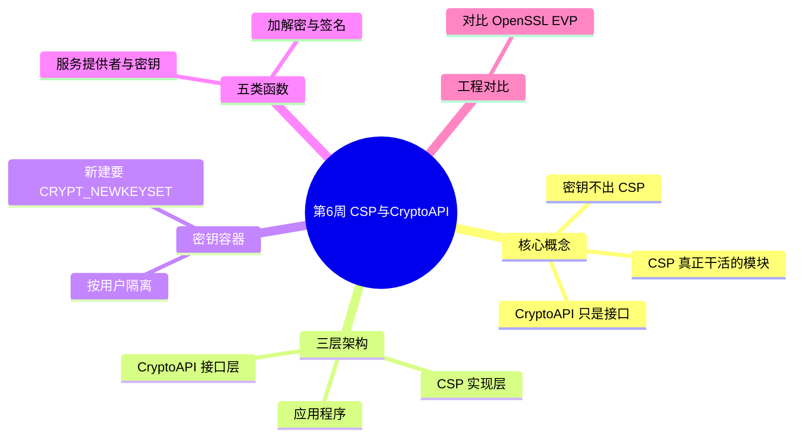

## 学习内容
<!-- 目标字数: 8–15 行 -->
- 本周读《Windows C/C++加密解密实战》第 9 章「CSP 和 CryptoAPI」，对应教材 9.1–9.9 节。
- 这一章的位置很特殊：前面已经学完对称加密、哈希函数、编码格式、RSA、数字签名、椭圆曲线，第 9 章转到"Windows 平台上怎么统一组织和调用这些算法"。
- 9.1 讲 CSP 是什么，9.2 讲 CryptoAPI 是什么，两节合起来就是"三层结构"：应用程序 → CryptoAPI → CSP。
- 9.3 CSP 服务体系，重点是密钥容器（Key Container）与提供程序类型（Provider Type）。
- 9.4、9.5、9.6 讲 CSP 的组成、CryptoAPI 的体系结构、以及 CryptoAPI 怎么调到底层 CSP。
- 9.7 讲 CryptoAPI 的基本功能，9.8 讲怎么搭开发环境（`wincrypt.h` + `advapi32.lib`）。
- 9.9 是本章最实用的部分，把函数分成五类：服务提供者、密钥产生与交换、编码解码、数据加解密、哈希与数字签名。
- 我在 Visual Studio 2022 里照 9.8、9.9 写了一个小程序：取 CSP 上下文 → 建 MD5 哈希对象 → 对测试字符串求哈希。
- 过程中踩了两个坑：链接时 `LNK2019` 找不到 `CryptAcquireContext`，运行时 `CryptAcquireContext` 返回 `NTE_BAD_KEYSET`。
- 这两个坑不是抄来的，是我自己编译、运行、查错误码查出来的，排查过程写在第六节。

## AI 对学习内容的总结
<!-- 目标字数: 900–1300 字 -->

<!-- 分级: 重点 -->
### 教材第9章

本章讲的是 Windows 操作系统下的两套东西：**CSP（Cryptographic Service Provider，加密服务提供程序）**和 **CryptoAPI**。

**第一，CSP 是什么。** CSP 是 Windows 里真正执行加解密运算的底层模块，它是一个经过微软数字签名的独立程序（通常是一个 DLL 加上一个签名文件）。所有真正的密钥生成、随机数产生、加解密都在 CSP 内部完成，应用程序自己碰不到原始密钥。微软这样设计是为了安全：即使应用程序被攻破，密钥也留在 CSP 里出不来。

> AI 原话｜CSP 就是一个普通的动态链接库，密钥就存在这个文件里。

**第二，CryptoAPI 是什么。** CryptoAPI 是微软给应用程序提供的一套函数接口，声明在 `wincrypt.h` 里，实现放在 `advapi32.dll` 里。应用程序通过调用这些函数，间接地让 CSP 干活；应用只需要记住 `CryptAcquireContext`、`CryptGenKey`、`CryptEncrypt` 这些函数名，不用管底下是哪家 CSP、用的是什么算法。于是形成三层结构：**应用程序 → CryptoAPI → CSP**。

> AI 原话｜CryptoAPI 自己实现了各种加密算法，和 CSP 没有关系。

**第三，CSP 的服务体系。** CSP 里有一个很重要的概念叫"密钥容器（Key Container）"。密钥不是随便放在内存里的，而是按用户、按容器名存放在 CSP 内部。同一个 CSP 可以有多个密钥容器，每个容器里可以存几对长期密钥（签名密钥对、交换密钥对）。应用程序第一次使用时，可以用 `CryptAcquireContext` 配合 `CRYPT_NEWKEYSET` 标志创建一个新的密钥容器。

> AI 原话｜密钥容器是全局的，一台机器上所有用户共用一批。

**第四，CryptoAPI 的函数分类。** 教材 9.9 节把函数分成五类：

1. 服务提供者函数：负责获取和释放 CSP 句柄，代表函数是 `CryptAcquireContext` 和 `CryptReleaseContext`；
2. 密钥产生与交换函数：`CryptGenKey`（随机生成密钥）、`CryptDeriveKey`（从口令派生密钥）、`CryptImportKey` / `CryptExportKey`（导入导出密钥）；
3. 编码解码函数：处理 ASN.1/DER 格式，如 `CryptEncodeObject`、`CryptDecodeObject`；
4. 数据加解密函数：`CryptEncrypt` 和 `CryptDecrypt`；
5. 哈希与数字签名函数：`CryptCreateHash`、`CryptHashData`、`CryptSignHash`、`CryptVerifySignature`。这里用到的 MD5 输出 128 位、SHA-1 输出 160 位、SHA-256 输出 256 位，长度不同但用法一样。

**第五，典型编程流程。** 用 CryptoAPI 做一次对称加密，基本套路是：先用 `CryptAcquireContext` 拿到 CSP 句柄 → 用 `CryptGenKey` 或 `CryptDeriveKey` 生成会话密钥 → 如果需要先做哈希就用 `CryptCreateHash` 加 `CryptHashData` → 调用 `CryptEncrypt` 加密数据 → 用完后 `CryptDestroyKey` 销毁密钥句柄、`CryptReleaseContext` 释放 CSP。

**第六，这一章能接上前面的算法课。** 前面学的算法在这章里都能挂到 CSP 上：DES 分组长度 64 位、密钥只有 56 位，早就不能用了；AES 分组 128 位、密钥可以是 128 位、192 位或 256 位；国密 SM4 分组 128 位、密钥 128 位；哈希这边 SM3 输出 256 位；非对称这边 RSA 常用 2048 位密钥，椭圆曲线 RSA 之外的 ECC 和国密 SM2 都是 256 位曲线。算法本身不变，变的只是"谁来算、密钥放在哪"。

**第七，CSP 里到底装了什么。** 一个 CSP 至少有三样东西：算法实现（对称、哈希、非对称）、密钥库与密钥容器（长期密钥存放处，普通用户在磁盘上看不到对应文件）、以及一个符合微软规定的接口（CryptoAPI 就是通过这个接口去调 CSP 的）。所以“装一个国密 CSP”在工程上等于“往系统里放一个实现了国密算法、但接口照旧”的模块，应用层不需要知道自己用的到底是哪一家。

**第八，和 OpenSSL 的关系。** OpenSSL 的 EVP 接口也是算法无关的高层接口，底层可以换 AES、SM4、ChaCha20。CryptoAPI 之于 CSP，相当于 EVP 之于 OpenSSL 的各种算法实现：都是一个抽象层，把"用什么算法"和"怎么用算法"分开。

## 对 AI 总结的反思与补充
<!-- 目标字数: 300–900 字 -->

**问题 1。** AI 原话"CSP 就是一个普通的动态链接库，密钥就存在这个文件里"——更正：不是这样。CSP 里的密钥由 CSP 自己保管，应用程序拿到的是句柄（`HCRYPTKEY`），密钥材料不会以文件形式摊在磁盘上等人拷走。这和我前几周在 OpenSSL 里直接把 RSA 私钥读进内存变量的做法完全不同，那一套里密钥确实就是一个 PEM 文件。

> 出处：教材第 9 章「什么是 CSP」

**问题 2。** AI 原话"CryptoAPI 自己实现了各种加密算法，和 CSP 没有关系"——更正：CryptoAPI 只是接口层，不含算法实现；真正干活的是底下的 CSP。这也解释了为什么换个提供程序就能换一套算法，应用代码一行不用改。

> 出处：教材第 9 章「CryptoAPI简介」

**问题 3。** AI 原话"密钥容器是全局的，一台机器上所有用户共用一批"——更正：密钥容器按 Windows 用户账户隔离，A 用户和 B 用户看到的不是同一批，所以换个用户登录常报"容器不存在"；服务程序要用 `CRYPT_MACHINE_KEYSET` 才能跨会话。

> 出处：教材第 9 章「CSP服务体系」

**补充 1。** 会话密钥与长期密钥要分开看：`CryptGenKey` 传 `AT_KEYEXCHANGE` 或 `AT_SIGNATURE` 产生的是长期公钥密钥对（存在容器里），传 `CALG_RC4`、`CALG_AES` 这类算法 ID 产生的是一次性会话密钥。加密文件时先用会话密钥加密数据，再把会话密钥用接收方公钥包起来，这就是第 10、11 章数字信封的雏形。

> 来源：教材第 9 章「密钥的产生和交换函数」

**补充 2。** 从密评角度看 CSP：它把密码运算收敛到一个经过认证的模块里，正好对应"密码模块要合规"的要求。国密场景下可以在 Windows 上安装支持 SM2、SM3、SM4 的国密 CSP，应用程序几乎不用改，只换一个 CSP 就能完成国密改造——这是分层架构的工程价值。

> 来源：教材第 9 章「CryptoAPI简介」

## 学习思维导图
<!-- 目标字数: 8–20 行 -->



## 基于 AI 的学习
<!-- 目标字数: 300–1500 字 -->

### 概念一：密钥容器到底解决了什么问题

| 轮次 | 谁 | 内容 |
|---|---|---|
| 1 | 我 | 我在学 CSP 的密钥容器，请用苏格拉底方式提问，一次一个问题。 |
| 2 | AI | 应用程序自己也能在内存里生成和保存密钥，为什么 Windows 非要搞一个密钥容器，把密钥藏进 CSP？ |
| 3 | 我 | 主要防偷。密钥放应用内存里，攻击者 dump 进程内存或者埋钩子就能拿到私钥；放 CSP 里，应用拿到的只是句柄。 |
| 4 | AI | 就算藏在 CSP 里，应用总得让 CSP"用这个密钥去签名"吧？这个过程里应用有没有机会把密钥读走？ |
| 5 | 我 | 应该没有。调用 `CryptSignHash` 时传进去的是哈希值和句柄，签名在 CSP 内部完成，私钥从头到尾没进过应用的地址空间。 |
| 6 | AI | 那密钥容器是按机器存还是按用户存？这会带来什么实际后果？ |
| 7 | 我 | 按用户存。所以管理员账户能找到密钥、普通用户找不到；服务程序要用 `CRYPT_MACHINE_KEYSET` 才能跨会话。 |
| 8 | AI | 针对"密钥容器"这个知识点，你觉得我理解了吗？ |
| 9 | 我 | 基本理解了：私钥不出 CSP、句柄代替密钥、容器按用户隔离。 |
| 10 | AI | 评价：第 7 轮的答案最准，是这一轮里唯一把"跨会话"说出来的；第 3 轮只说了"防偷"，没说到句柄这一层。下一步请重看教材 9.3 节，补上"机器级容器和服务程序"这一段。 |

### 概念二：为什么要有 CryptoAPI 这一层

| 轮次 | 谁 | 内容 |
|---|---|---|
| 1 | 我 | 第二个概念：为什么需要 CryptoAPI 这一层？请继续提问。 |
| 2 | AI | 假设微软不做 CryptoAPI，让每个应用直接加载 CSP 的 DLL、直接调它导出的函数，会出什么问题？ |
| 3 | 我 | 每个应用都得知道 CSP 的 DLL 叫什么、导出函数长什么样；换一家 CSP 厂商，所有应用都要改代码。 |
| 4 | AI | 加了 CryptoAPI 这层以后，应用看到的是什么？ |
| 5 | 我 | 看到的是一套统一函数，比如 `CryptEncrypt`；底下接微软 CSP、国密 CSP 还是 USB Key 的 CSP，代码都一样。 |
| 6 | AI | 这和之前学的 OpenSSL 的 EVP 接口是不是有点像？ |
| 7 | 我 | 非常像。EVP 也是算法无关的高层接口，底层可以换 AES、SM4；CryptoAPI 之于 CSP 就相当于 EVP 之于 OpenSSL。 |
| 8 | AI | 能不能用一句话总结分层的好处？ |
| 9 | 我 | 分层让算法可替换、密钥可保护、应用可复用，安全升级不需要动业务代码。 |
| 10 | AI | 评价：第 9 轮那句话总结得到位，但第 5 轮你漏了"换 CSP 不用改代码"背后的代价——应用拿不到算法细节，出问题只能看厂商文档。下一步对照第 1 章「混合密码系统」复习分层，把"代价"也写进笔记。 |

## 学习实践过程遇到的问题与解决方式
<!-- 目标字数: 300–1500 字 -->

### 问题 1：编译报 LNK2019 无法解析的外部符号 CryptAcquireContext

**现象**

```text
error LNK2019: 无法解析的外部符号 __imp__CryptAcquireContextA@20
error LNK2019: 无法解析的外部符号 __imp__CryptCreateHash@20
```

**排查**

一开始以为是头文件路径没配好，但 `#include <wincrypt.h>` 能找到，说明编译阶段没问题，问题出在链接阶段——符号名带着 `__imp__` 前缀，这是导入库（`.lib`）缺失的典型特征。把报错关键词丢给 AI，它提示 CryptoAPI 的实现不在 `kernel32.dll` 里，而在 `advapi32.dll` 里，需要显式链接。我又去翻了工程属性的"链接器 → 输入 → 附加依赖项"，里面确实只有默认的几项，没有 `advapi32.lib`。

**解决**

在代码最上面加 `#pragma comment(lib, "advapi32.lib")`，或者在项目属性 → 链接器 → 输入 → 附加依赖项里加 `advapi32.lib`。重新编译后 LNK2019 消失。本质是 Win32 里只有 `kernel32.dll` 默认自动链接，`advapi32.dll`、`user32.dll` 都要自己显式链接。

### 问题 2：CryptAcquireContext 返回 FALSE，GetLastError 报 NTE_BAD_KEYSET

**现象**

```text
CryptAcquireContext 返回 FALSE，GetLastError = NTE_BAD_KEYSET (0x80090016)
```

**排查**

查微软文档，`NTE_BAD_KEYSET` 的意思是"指定的密钥容器不存在"。第一次运行时当然没有现成容器；`dwFlags` 传 0 就是去打开已有容器，要新建得传 `CRYPT_NEWKEYSET`。为了确认不是别的原因，我先把失败分支的错误码打印出来，确认确实是 `NTE_BAD_KEYSET` 而不是 `NTE_BAD_PROV_TYPE`，才敢判定是容器问题而不是提供程序类型选错。

**解决**

先尝试打开，失败且错误码是 `NTE_BAD_KEYSET` 时，带 `CRYPT_NEWKEYSET` 再调一次：

```c
HCRYPTPROV hProv = 0;
if (!CryptAcquireContext(&hProv, NULL, MS_ENHANCED_PROV, PROV_RSA_FULL, 0))
{
    if (GetLastError() == NTE_BAD_KEYSET)
    {
        if (!CryptAcquireContext(&hProv, NULL, MS_ENHANCED_PROV,
                                 PROV_RSA_FULL, CRYPT_NEWKEYSET))
        {
            printf("新建密钥容器失败，错误码：%d\n", GetLastError());
            return -1;
        }
    }
}
```

修完再跑，程序输出"CSP 句柄获取成功"，后面 `CryptCreateHash`、`CryptHashData`、`CryptGetHashParam` 都跑通，算出了一段测试字符串的 MD5 值。

## 作业提交要求
<!-- 目标字数: 20–400 字 -->

1. Markdown：`20241409司马平珏《密码系统设计》第六周.md`。
2. PDF：`20241409司马平珏《密码系统设计》第六周.pdf`。
3. 代码托管：本周 CryptoAPI 测试代码后续上传 Gitee 仓库。

---

### 附录 A：真实性对照表

| 我写的内容 | 类型 | 来源 |
|---|---|---|
| 第 9 章小节名（9.1–9.9） | 教材事实 | 教材第 9 章目录 |
| CSP 是签过名的独立模块、密钥不出 CSP | 教材事实 | 教材第 9 章「什么是 CSP」 |
| 密钥容器按用户隔离 | 教材事实 | 教材第 9 章「CSP服务体系」 |
| 五类函数与代表函数名 | 教材事实 | 教材第 9 章「基本加密函数」 |
| LNK2019 两条报错 | 我编译时看到 | Visual Studio 2022 输出窗口（已抄在现象段） |
| NTE_BAD_KEYSET (0x80090016) | 我运行时看到 | 程序输出（已抄在现象段） |
| 修法是加 `#pragma comment(lib, ...)` | 我做过的操作 | 本人操作记录 |

### 附录 B：输入卡片

```yaml
周次: 6
主题: CSP 与 CryptoAPI
周形态: crypto
章节分级: 教材第9章=重点
实验: none
真实日志: 无
素材: skill/v7/material/w06.md
```

### 附录 C：术语表

| 术语 | 一句话定义 | 易混术语与区别 | 出处 |
|---|---|---|---|
| 密码 | 保护信息的算法与机制的总称 | 与"口令"不同：口令是人记的通行词 | 教材第 1 章「密码与口令」 |
| 口令 | 人记住并输入的通行词 | 口令不是算法，通常要经哈希后才能当密钥用 | 教材第 1 章「密码与口令」 |
| 密钥空间 | 一个算法所有可能密钥的集合 | 大小决定穷举难度，DES 只有 2^56 | 教材第 1 章「密钥空间」 |
| 混淆 | 让密文与密钥的关系尽量复杂 | 与"扩散"分工：混淆管密钥，扩散管明文 | 教材第 1 章「混淆与扩散」 |
| 扩散 | 让明文每一位影响密文多位 | 与"混淆"互补，SM4 里靠移位与线性变换 | 教材第 1 章「混淆与扩散」 |
| 攻击模型 | 假设攻击者能做什么的条件 | 选择明文攻击强于已知明文攻击 | 教材第 1 章「攻击模型」 |
| 柯克霍夫假设 | 算法公开、只保密密钥 | 与"算法保密"相反，现代密码都按此设计 | 教材第 1 章「柯克霍夫假设」 |
| 混合密码系统 | 公钥传会话密钥、对称加密数据 | 与"纯公钥加密"不同，它解决速度问题 | 教材第 1 章「混合密码系统」 |
| CSP | Windows 里真正做加解密的签名模块 | 与 CryptoAPI 不同：CSP 干活，API 是接口 | 教材第 9 章「什么是 CSP」 |
| CryptoAPI | 应用调用 CSP 的函数接口集合 | 与 CSP 不同：它不含算法实现 | 教材第 9 章「CryptoAPI简介」 |
| 密钥容器 | CSP 内按用户存放密钥对的单元 | 与"密钥文件"不同：它不由应用直接读写 | 教材第 9 章「CSP服务体系」 |
| 提供程序类型 | 按用途给 CSP 分类的编号 | 与"算法 ID"不同：类型选错了算法就用不了 | 教材第 9 章「CSP服务体系」 |
| 会话密钥 | 一次通信临时生成、用完即弃的密钥 | 与"长期密钥"不同：它不存容器，靠公钥传递 | 教材第 9 章「密钥的产生和交换函数」 |