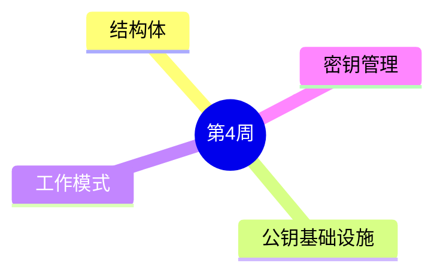

<!-- 结构样本：只用于验证 C19 三档同现，正文是占位文字，不是可提交的作业 -->

## 学习内容
<!-- 目标字数: 8–15 行 -->
- 占位。

## AI 对学习内容的总结
<!-- 目标字数: 900–1300 字 -->

<!-- 分级: 重点 -->
### Head First C 第5章

这一章讲结构体与指针，重点在内存布局和用指针访问成员。这一节要写清概念、写清数字、写清与本课程其他章的关联。占位文字。占位文字。占位文字。占位文字。占位文字。占位文字。占位文字。占位文字。占位文字。占位文字。占位文字。占位文字。占位文字。占位文字。占位文字。占位文字。占位文字。占位文字。占位文字。占位文字。占位文字。占位文字。占位文字。占位文字。占位文字。占位文字。占位文字。占位文字。占位文字。占位文字。占位文字。占位文字。占位文字。占位文字。占位文字。占位文字。占位文字。占位文字。占位文字。占位文字。占位文字。占位文字。占位文字。占位文字。占位文字。占位文字。占位文字。占位文字。占位文字。占位文字。占位文字。占位文字。占位文字。占位文字。占位文字。占位文字。占位文字。占位文字。占位文字。占位文字。占位文字。占位文字。占位文字。占位文字。占位文字。占位文字。占位文字。占位文字。占位文字。占位文字。占位文字。占位文字。占位文字。占位文字。占位文字。占位文字。占位文字。占位文字。占位文字。占位文字。占位文字。占位文字。占位文字。占位文字。占位文字。占位文字。占位文字。占位文字。占位文字。占位文字。占位文字。占位文字。占位文字。占位文字。占位文字。占位文字。占位文字。占位文字。占位文字。占位文字。占位文字。占位文字。占位文字。占位文字。占位文字。占位文字。

<!-- 分级: 重点 -->
### 教材第14章

第 14 章是本周重点：公钥基础设施的组成、证书链验证路径、吊销检查。这一节要写清概念、写清数字、写清与本课程其他章的关联。占位文字。占位文字。占位文字。占位文字。占位文字。占位文字。占位文字。占位文字。占位文字。占位文字。占位文字。占位文字。占位文字。占位文字。占位文字。占位文字。占位文字。占位文字。占位文字。占位文字。占位文字。占位文字。占位文字。占位文字。占位文字。占位文字。占位文字。占位文字。占位文字。占位文字。占位文字。占位文字。占位文字。占位文字。占位文字。占位文字。占位文字。占位文字。占位文字。占位文字。占位文字。占位文字。占位文字。占位文字。占位文字。占位文字。占位文字。占位文字。占位文字。占位文字。占位文字。占位文字。占位文字。占位文字。占位文字。占位文字。占位文字。占位文字。占位文字。占位文字。占位文字。占位文字。占位文字。占位文字。占位文字。占位文字。占位文字。占位文字。占位文字。占位文字。占位文字。占位文字。占位文字。占位文字。占位文字。占位文字。占位文字。占位文字。占位文字。占位文字。占位文字。占位文字。占位文字。占位文字。占位文字。占位文字。占位文字。占位文字。占位文字。占位文字。占位文字。占位文字。占位文字。占位文字。占位文字。占位文字。占位文字。占位文字。占位文字。占位文字。占位文字。占位文字。占位文字。占位文字。占位文字。占位文字。占位文字。占位文字。占位文字。占位文字。占位文字。占位文字。占位文字。占位文字。占位文字。占位文字。占位文字。占位文字。

<!-- 分级: 了解 -->
### 教材第6章

第 6 章了解即可：讲分组密码的几种工作模式，与第 1 周有重叠。这一节要写清概念、写清数字、写清与本课程其他章的关联。占位文字。占位文字。占位文字。占位文字。占位文字。占位文字。占位文字。占位文字。占位文字。占位文字。占位文字。占位文字。占位文字。占位文字。占位文字。占位文字。占位文字。占位文字。占位文字。占位文字。占位文字。占位文字。占位文字。占位文字。占位文字。占位文字。占位文字。占位文字。占位文字。占位文字。占位文字。占位文字。占位文字。占位文字。占位文字。占位文字。

<!-- 分级: 参考 -->
### 教材第8章

第 8 章作参考：讲哈希的应用场景，本周不展开。这一节要写清概念、写清数字、写清与本课程其他章的关联。占位文字。占位文字。占位文字。占位文字。占位文字。占位文字。占位文字。占位文字。占位文字。占位文字。占位文字。占位文字。

<!-- 分级: 参考 -->
### 教材第13章

第 13 章作参考：讲密钥管理，本周只需要知道有密钥生命周期这回事。这一节要写清概念、写清数字、写清与本课程其他章的关联。占位文字。占位文字。占位文字。占位文字。占位文字。占位文字。占位文字。占位文字。

## 对 AI 总结的反思与补充
<!-- 目标字数: 300–900 字 -->
**问题 1。** 占位。

> 出处：占位。

**更正：** 占位。

## 学习思维导图
<!-- 目标字数: 8–20 行 -->


## 基于 AI 的学习
<!-- 目标字数: 300–1500 字 -->
占位。

## 学习实践过程遇到的问题与解决方式
<!-- 目标字数: 300–1500 字 -->
### 问题 1：占位
**现象**
```
占位
```
**排查**
$ ls
**解决**
占位。

## 作业提交要求
<!-- 目标字数: 20–400 字 -->
占位。

---

### 附录 A：真实性对照表
| 我写的内容 | 类型 | 来源 |
|---|---|---|

### 附录 B：输入卡片
- 章节分级: 名称=档位/…
